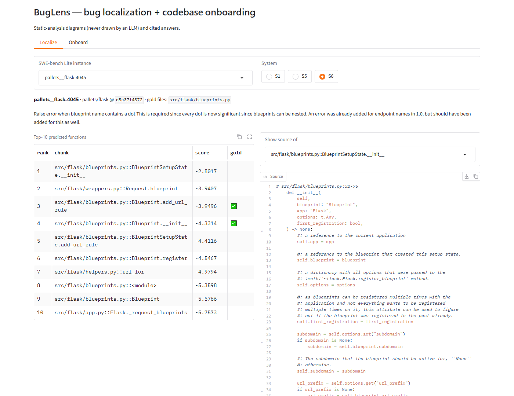
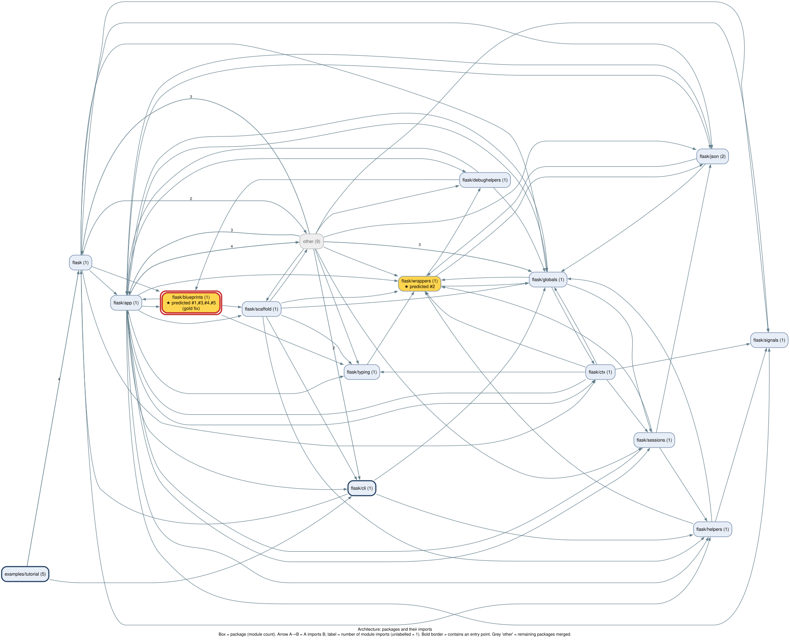
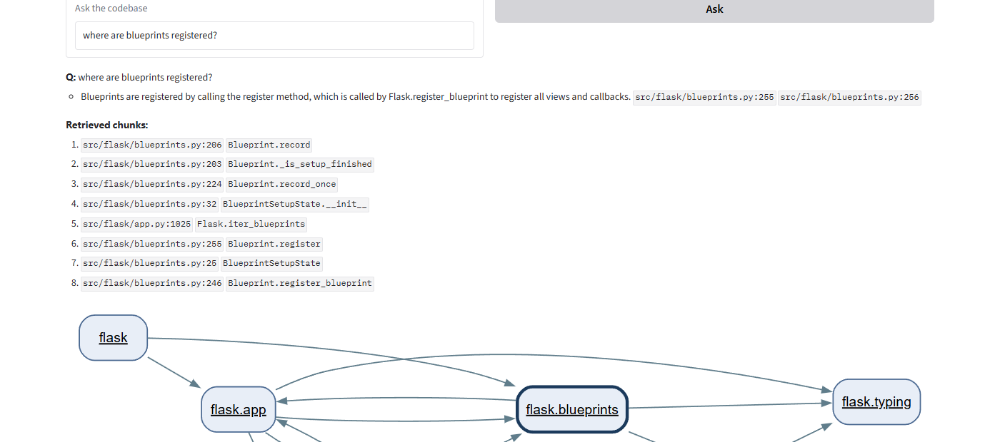
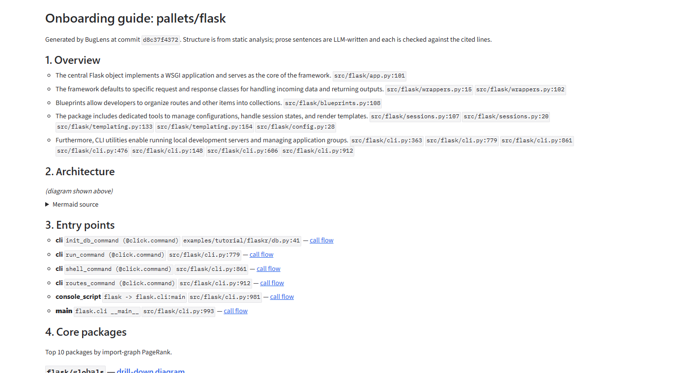
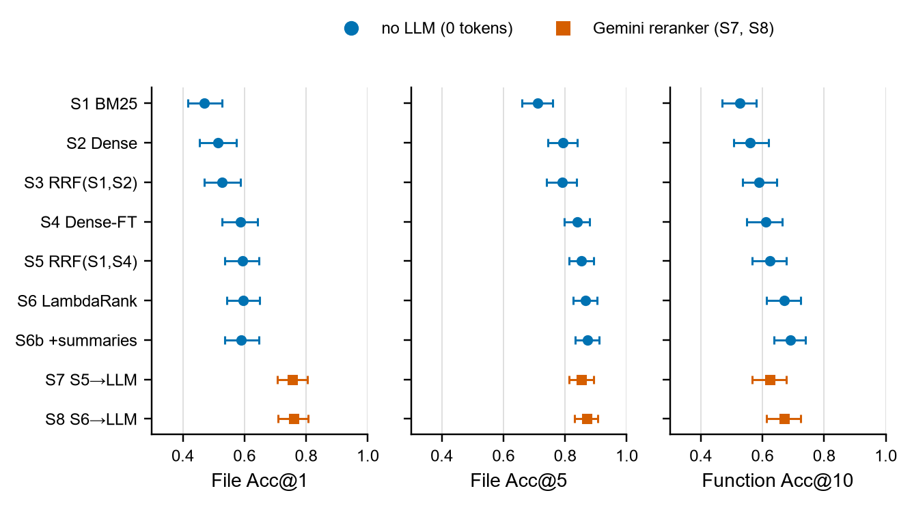
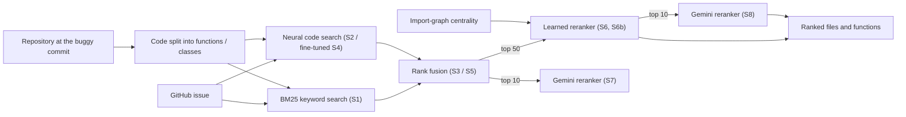

# BugLens

**Finding where to fix a bug from its issue description, and helping newcomers understand a codebase.**

[](https://github.com/Icoder05/buglens/actions/workflows/ci.yml)

[](LICENSE)
[](reports/research/BugLens_Research_Report.pdf)

> **In one sentence:** on 300 real GitHub issues from 12 Python projects (SWE-bench Lite), BugLens'
> best pipeline without an AI model puts a correct file in its top 5 suggestions for **86.7%** of
> issues, and adding a free-tier Gemini reranker makes the **first** suggestion correct for **76.0%**
> (up from 59.7%) — measured with confidence intervals, repeated runs and paired statistical tests.

| 📄 [Research report (PDF)](reports/research/BugLens_Research_Report.pdf) | 📊 [Analysis workbook (Excel)](reports/research/BugLens_Research_Analysis.xlsx) | 📈 [All results](reports/results.md) | 🧭 [Plain-language concepts](docs/CONCEPTS.md) | ▶️ [How to run](docs/HOW_TO_RUN.md) |
| --- | --- | --- | --- | --- |



---

## Contents

1. [The problem](#the-problem)
2. [What BugLens does](#what-buglens-does)
3. [Results](#results)
4. [How it works](#how-it-works)
5. [Research questions and answers](#research-questions-and-answers)
6. [Run it yourself](#run-it-yourself)
7. [Project structure](#project-structure)
8. [Reproducibility](#reproducibility)
9. [Limitations](#limitations)
10. [Future work](#future-work)
11. [Tech stack, references and license](#tech-stack-references-and-license)

## The problem

When a bug is reported, the first job is **localization**: deciding which of thousands of files and
functions must change. It is slow for experienced developers and much harder for newcomers who do not
yet know the code. Modern systems often hand this to large language models (LLMs) or agents, which
are capable but costly and not fully repeatable. This project measures **how far cheaper, reproducible
methods can go, where an LLM adds value, and what that value costs** — and builds tools that help a
newcomer understand an unfamiliar repository.

## What BugLens does

**1. Localize** — given a GitHub issue and the repository at the commit where the bug existed, rank
the files and functions most likely to need the fix. Nine systems are compared, from keyword search
to an LLM reranker.

**2. Onboard** — for a newcomer: an architecture diagram, drill-down diagrams, a cited onboarding
guide and an "ask the codebase" box that answers with `file:line` references.

The two modes share one index, and they meet in one view: the predicted bug locations are highlighted
on the architecture diagram (yellow = predicted, red outline = where the real fix was).



| Ask the codebase (answer cites real code lines) | Generated onboarding guide (every sentence is cited) |
| --- | --- |
|  |  |

## Results

SWE-bench Lite test set, 300 issues. Brackets: 95% bootstrap confidence interval.

| System | What it does | File Acc@1 | File Acc@5 | Function Acc@10 | LLM tokens / issue |
| --- | --- | --- | --- | --- | --- |
| S1 | Keyword search (BM25) | 47.0% | 71.0% [66–76] | 52.7% | 0 |
| S2 | Neural code search (CodeRankEmbed) | 51.3% | 79.3% [74–84] | 56.0% | 0 |
| S3 | S1 + S2 combined (rank fusion) | 52.7% | 79.0% [74–84] | 59.0% | 0 |
| S4 | Neural search, fine-tuned on 16 other repos | 58.7% | 84.0% [80–88] | 61.0% | 0 |
| S5 | S1 + S4 combined | 59.3% | 85.3% [81–89] | 62.3% | 0 |
| **S6** | **S5 + learned reranker (LambdaRank)** | 59.7% | **86.7%** [83–90] | 67.0% | **0** |
| S6b | S6 + onboarding summaries as a feature | 59.0% | 87.3% [83–91] | **69.0%** | 0 |
| S7 | S5 + Gemini reranks the top 10 | 75.7% | 85.3% [81–89] | 62.3% | 5,168 |
| **S8** | **S6 + Gemini reranks the top 10** | **76.0%** | **87.0%** [83–91] | 67.0% | 6,002 |

*Acc@k = share of issues where a correct file/function is among the first k suggestions.
S7/S8 only reorder the top 10, so their Acc@10 equals that of their input.*

<p align="center">
  
</p>

**What the numbers say (under the tested conditions):**

- Cheap components carry most of the top-5 accuracy: 71.0% → 86.7% with **zero LLM calls**.
- The LLM mainly improves the **first** answer (+16 points file Acc@1, p < 0.001) at ~5–6k tokens and
  ~5 s per issue; it does not improve the top-10 list.
- Running the LLM step three times on the same 50 issues gave the same first answer for 86% of them,
  so single-run LLM numbers vary by about ±2 points.
- In 15 of 20 analysed failures the issue describes a symptom while the fix is in a different, often
  lower-level, module.

Full analysis: [research report](reports/research/BugLens_Research_Report.pdf) (34 pages, 17 figures,
19 tables) and [results.md](reports/results.md).

## How it works



1. Each repository is read straight from git at the issue's commit and split into code chunks along the
   Python syntax tree.
2. The correct answers (gold labels) are derived automatically from the real fixing patch.
3. Retrieval ranks chunks with keyword search (BM25) and a neural code encoder; the encoder was
   fine-tuned on 3,000 issue → fix examples from 18 repositories that are **disjoint** from the test set.
4. A LambdaRank model re-orders the top 50 using 21 signals; an LLM can reorder the top 10.
5. For onboarding, static analysis builds import, inheritance and call graphs; every diagram element is
   re-verified against these graphs (100% on all 90 diagrams), and every LLM-written sentence must cite a
   real line it was shown.

More detail: [docs/ARCHITECTURE.md](docs/ARCHITECTURE.md) · terms explained: [docs/CONCEPTS.md](docs/CONCEPTS.md).

## Research questions and answers

| | Question | Answer (95% CI) | Verdict |
| --- | --- | --- | --- |
| RQ1 | Does combining keyword and neural search beat either alone? | Beats keyword search (+8.0 pts file Acc@5); vs neural search alone −0.3 pts file / +3.0 pts function, both CIs include 0 | Partly |
| RQ2 | Does fine-tuning on other repositories help on unseen ones? | +4.7 pts file Acc@5 [+0.7, +8.7]; in the fused system +6.3 pts [+3.0, +10.0] | Supported |
| RQ3 | Does a learned reranker close the gap to an LLM reranker? | Yes for top-5/10 (S6 ≥ S7 at 0 tokens); no for the first answer (LLM +16 pts) | Split by rank |
| RQ4 | Do onboarding summaries help ranking as a feature? | +2.0 pts function Acc@10 [−0.7, +4.7] | Not established |

Onboarding evaluation: 90 diagrams 100% verified · 107 of 108 summary sentences kept by the citation
validator · 25 of 29 summaries rated correct, 4 partly, 0 wrong · "ask the codebase" retrieves a right
file in the top 5 for 14 of 15 test questions.

## Run it yourself

```bash
git clone https://github.com/Icoder05/buglens.git
cd buglens
make setup        # install (uv, Python 3.11, pinned versions)
make test         # 70 unit tests
make demo         # web app at http://127.0.0.1:7860
```

Rebuilding the experiments needs the ~7 GB experiment data (cloned repositories, caches, fine-tuned
model), which is created by `make experiments` and is not stored in git. Step-by-step instructions,
all commands and troubleshooting: **[docs/HOW_TO_RUN.md](docs/HOW_TO_RUN.md)**.

## Project structure

```text
buglens/
├── src/buglens/        Python package (every module starts with a docstring explaining its concept)
│   ├── data/           SWE-bench loading, git access at any commit, gold labels
│   ├── chunking/       split code into function / class / module chunks
│   ├── retrieval/      BM25, neural encoder, rank fusion
│   ├── training/       fine-tuning data and scripts
│   ├── rerank/         LambdaRank features and training
│   ├── analysis/       static analysis: imports, classes, calls, PageRank
│   ├── onboard/        diagrams, cited summaries, guide, ask-the-codebase
│   ├── llm/            Gemini client, LLM reranker, patch generation
│   ├── eval/           metrics, statistics, reports
│   └── demo/           Gradio web app
├── configs/            all settings and the experiment plan
├── tests/              70 unit tests
├── runs/               per-issue rankings of every system (the evidence behind every number)
├── reports/            results, error analysis, research report + workbook  → see reports/README.md
├── onboarding/         generated guides and diagrams for flask, requests, django
├── docs/               how to run, architecture, concepts, screenshots
├── notebooks/          Kaggle notebook for fine-tuning on a free cloud GPU
└── scripts/            resumable pipelines and report builders
```

## Reproducibility

- **Pinned environment** (`uv.lock`), fixed random seeds, configuration in `configs/`.
- **Every run stores its git commit and configuration**; every pipeline step is logged with timestamps.
- **Content-addressed caches** for chunks, embeddings and LLM answers: `make reproduce` rebuilds all results
  in about 9 minutes with **0** API calls, giving identical rankings and metrics.
- **No test leakage:** fine-tuning repositories are disjoint from test repositories (asserted in code), and
  every LLM prompt is checked against the gold patches before it is sent.
- Deviations from the original plan are listed in [CHANGELOG.md](CHANGELOG.md).

## Limitations

- One benchmark (SWE-bench Lite), Python only; two repositories (django, sympy) provide 64% of issues.
- Mostly single-file fixes; static call graphs are approximate.
- One run per system; variability was estimated with targeted repeated runs, not by repeating every system.
- One LLM version (free tier) on specific dates; hosted LLM outputs are not perfectly repeatable.
- Encoders and the LLM may have seen these public repositories during pre-training.
- 30 generated patches were not executed against tests, so no repair rate is claimed.
- No user study: onboarding results show faithfulness and grounding, not that people learn faster.

## Future work

Follow import and call relations from the top candidates (the main failure pattern) · repeat all systems
over several seeds and LLM runs · multi-file bugs and the full SWE-bench · run the generated patches with the
official test harness (`make harness`) · a user study on onboarding.

## Tech stack, references and license

Python 3.11 · uv · PyTorch · sentence-transformers · FAISS · bm25s · LightGBM · NetworkX · Graphviz ·
Gradio · Google Gemini API · pandas / SciPy / matplotlib · pytest · ruff.

- C. E. Jimenez et al., *SWE-bench: Can Language Models Resolve Real-World GitHub Issues?*, ICLR 2024.
- T. Suresh et al., *CoRNStack: High-Quality Contrastive Data for Better Code Retrieval and Reranking* (CodeRankEmbed), 2024.
- Full reference list in the [research report](reports/research/BugLens_Research_Report.pdf).

Released under the [MIT License](LICENSE). To cite this project, see [CITATION.cff](CITATION.cff).
