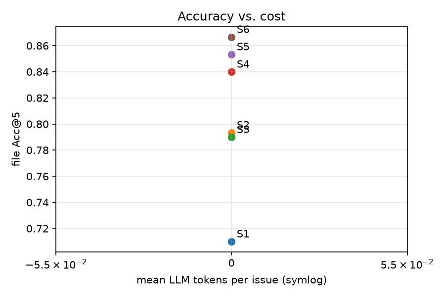
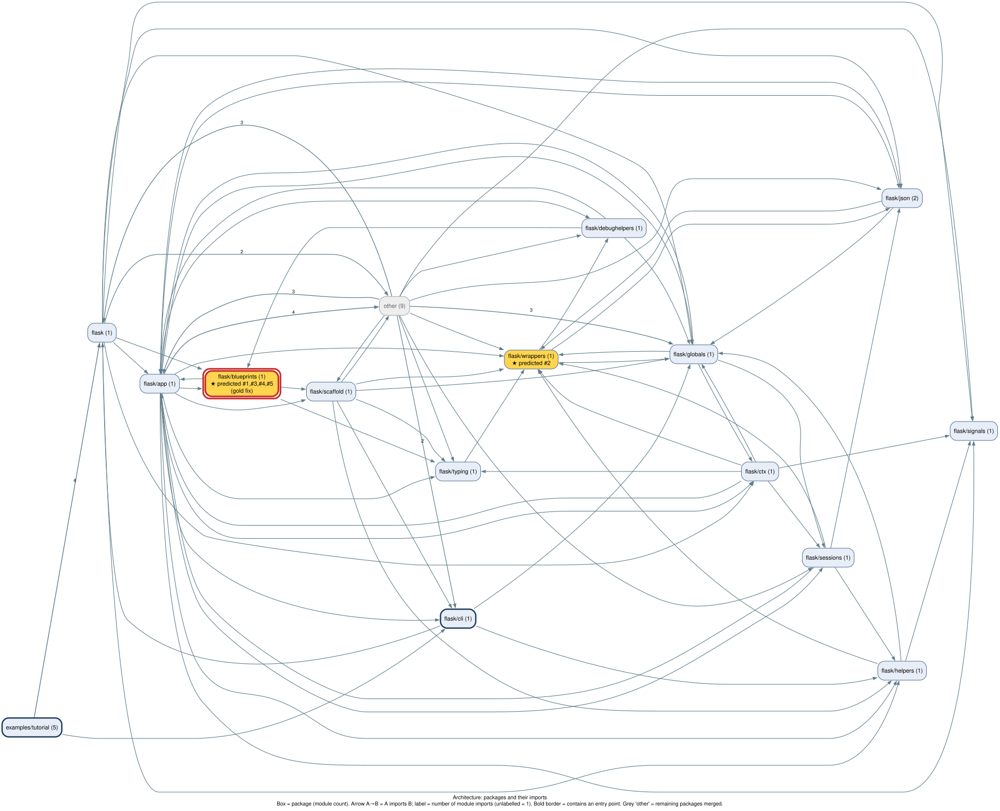
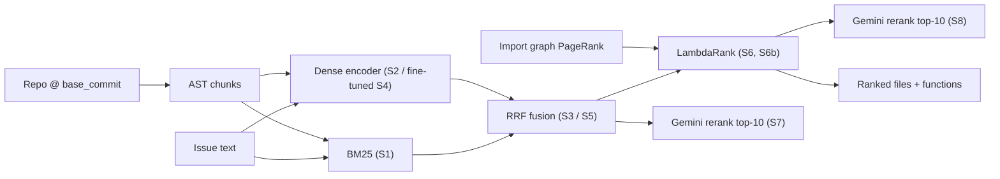
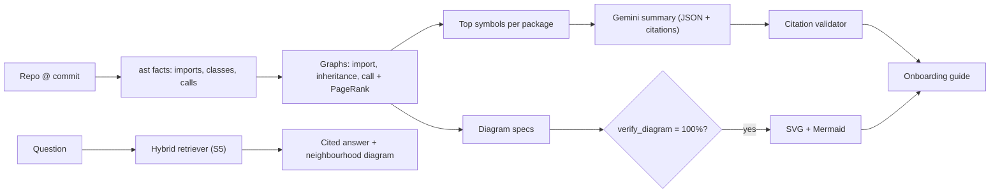

# BugLens

**Bug localization on SWE-bench Lite + static-analysis codebase onboarding, built on one shared index.**

> **Finding.** A fine-tuned code encoder fused with BM25 and reranked by a 21-feature LambdaRank model
> (**S6**) puts the file that needs fixing in its top 5 for **86.7%** [82.7, 90.3] of the 300
> SWE-bench Lite issues, and the exact function in its top 10 for **67.0%** [61.3, 72.3] — with
> **zero LLM tokens** and ~0.4 s per issue on a laptop GPU.

| System | Pipeline | File Acc@1 | File Acc@5 | Func Acc@10 | Func MRR | LLM tokens / issue |
| --- | --- | --- | --- | --- | --- | --- |
| S1 | BM25 | 0.470 | 0.710 | 0.527 | 0.311 | 0 |
| S2 | Dense (CodeRankEmbed) | 0.513 | 0.793 | 0.560 | 0.327 | 0 |
| S3 | RRF(S1, S2) | 0.527 | 0.790 | 0.590 | 0.368 | 0 |
| S4 | Dense (fine-tuned) | 0.587 | 0.840 | 0.610 | 0.381 | 0 |
| S5 | RRF(S1, S4) | 0.593 | 0.853 | 0.623 | 0.405 | 0 |
| **S6** | **S5 → LambdaRank** | **0.597** | **0.867** | **0.670** | **0.413** | **0** |
| S7 / S8 / S6b | Gemini reranker / summaries feature | _pending: needs `GEMINI_API_KEY`_ | | | | |

95% bootstrap CIs, paired tests and all metrics: [reports/results.md](reports/results.md).



**Localize meets Onboard.** The architecture block diagram of `pallets/flask`, built purely from
static analysis, with S6's top-5 predictions for issue
[flask-4045](https://github.com/pallets/flask/issues/4045) overlaid (yellow = predicted, ranks in
the box; red double outline = the package of the real fix):



---

## Two modes, one index

1. **Localize** — given a GitHub issue and a Python repo at the buggy commit, rank the files and
   functions most likely to need the fix (systems S1–S8, evaluated on SWE-bench Lite).
2. **Onboard** — for a newcomer: an architecture block diagram, drill-downs (package → modules,
   module → classes, entry point → call flow), a cited onboarding guide and an "ask the codebase" box.
   Diagrams are **never drawn by an LLM**: every node and edge is re-verified against the static
   analysis graphs (100% on all 90 generated diagrams). LLM-written sentences must cite `path:line`,
   enforced by a validator.

### Research questions
- **RQ1** Does hybrid retrieval (BM25 + dense) beat either alone? — *Over BM25 yes (+8.0 pts file
  Acc@5); over dense alone only at function level (+3.0 pts Acc@10, not significant).*
- **RQ2** Does contrastive fine-tuning on SWE-bench-train help on unseen repos? — *Yes: S4 vs S2
  +4.7 pts file Acc@5 (p = 0.03); S5 vs S3 +6.3 pts (p = 0.002).*
- **RQ3** Does a LambdaRank reranker close the gap to an LLM reranker? — *S6 adds +4.7 pts function
  Acc@10 over S5 (p = 0.008) at 0 tokens; the LLM comparison (S7) is pending a Gemini key.*
- **RQ4** Do onboarding package summaries help localization as a feature (S6b vs S6)? — *pending
  a Gemini key.*

### Method (in 10 bullets)
1. Repos are read straight from git objects at each `base_commit` (no checkouts); content-hash caches.
2. `ast` chunking: one chunk per function / method / class + one module chunk (windows if unparsable).
3. Gold labels: patch removed lines / insertion points → innermost chunk at `base_commit`.
4. **S1** BM25 with a code-aware tokenizer (camelCase / snake_case split + full identifiers).
5. **S2** CodeRankEmbed bi-encoder + FAISS exact inner product; SQLite embedding cache.
6. **S3/S5** Reciprocal Rank Fusion (k = 60) of BM25 and dense rankings.
7. **S4** CodeRankEmbed fine-tuned with cached MNRL (GradCache, batch 64) on 3,000 issue → gold
   function triples with BM25 hard negatives from 18 SWE-bench-*train* repos (disjoint from test).
8. **S6** LightGBM LambdaRank over S5's top 50 with 21 features (scores/ranks, issue mentions,
   tracebacks, chunk size/kind, import-graph PageRank), leave-one-repo-out over the 12 test repos.
9. **Onboard** facts → import / inheritance / call graphs → verified diagrams (Graphviz SVG + Mermaid).
10. Grounded summaries: the LLM sees only signatures/docstrings of top symbols; strict citation validator.





## Quick start

Requirements: Windows/Linux/macOS, [uv](https://docs.astral.sh/uv/), git, Graphviz (`dot`).
An NVIDIA GPU helps for encoding/fine-tuning but the demo runs on CPU.

```bash
make setup        # uv sync (Python 3.11 venv, pinned versions)
make test         # unit tests
make reproduce    # every number above from cached artifacts (< 10 min once data/ is built)
make onboard      # diagrams + guides for flask, requests, django, then onboarding eval
make demo         # Gradio app at http://127.0.0.1:7860 (Localize + Onboard tabs)
```

From scratch (hours: clones ~5 GB of repos, encodes ~180k chunks, fine-tunes):
`make experiments` (or run `scripts/resume_pipeline.ps1`, which is resumable).
For the LLM systems put `GEMINI_API_KEY=...` (free key from https://aistudio.google.com/apikey)
in `.env`, then `uv run buglens llm --system S7`, `make onboard`, `uv run buglens rerank --system S6b`.

The Kaggle notebook [`notebooks/kaggle_finetune.ipynb`](notebooks/kaggle_finetune.ipynb) runs the
same fine-tuning on a free T4/P100.

## Onboarding evaluation

| Repo | Diagrams | Elements verified | Ask-the-codebase QA Acc@5 |
| --- | --- | --- | --- |
| pallets/flask | 32 | 100% | 15 hand-written questions over flask + requests: **0.933** (14/15) |
| psf/requests | 27 | 100% | |
| django/django | 31 | 100% | |

All 62 Mermaid files render with the official Mermaid CLI. Citation validity and the 30-summary
human rating appear in [reports/onboarding_eval.md](reports/onboarding_eval.md) once summaries are
generated (needs the Gemini key). Generated guides: [flask](onboarding/pallets__flask/guide.md),
[requests](onboarding/psf__requests/guide.md), [django](onboarding/django__django/guide.md).

## Limitations
- SWE-bench Lite is mostly single-file bugs; multi-file localization is under-tested.
- Python only; static call graphs are approximate (dynamic dispatch, decorators stay unresolved).
- Summaries are rated by a single rater; free-tier model versions change over time.
- Possible pre-training contamination: these popular repos may be in the encoders'/LLM's training data.
- No user study — no claims about onboarding speed.

## Future work
LoRA-tuned LLM reranker · RL policy for repository navigation · execution feedback ·
multi-file bugs (full SWE-bench) · a user study on onboarding time. Error analysis
([reports/error_analysis.md](reports/error_analysis.md)) shows 15/20 misses are "symptom ≠ fix site",
so expanding candidates along import/call edges is the next experiment.

## Project layout
`src/buglens/` — `data/` (SWE-bench, git cache, labels) · `chunking/` · `analysis/` (facts, graphs,
packages, entry points) · `retrieval/` · `training/` · `rerank/` · `llm/` · `onboard/` · `eval/` ·
`demo/`. Every module starts with a docstring explaining the concept it implements.
Deviations from the PRD are listed in [CHANGELOG.md](CHANGELOG.md); the write-up is
[reports/writeup.md](reports/writeup.md).

## Citations
- C. E. Jimenez et al. *SWE-bench: Can Language Models Resolve Real-World GitHub Issues?* ICLR 2024.
- T. Suresh et al. *CoRNStack: High-Quality Contrastive Data for Better Code Ranking* (CodeRankEmbed), 2024.
