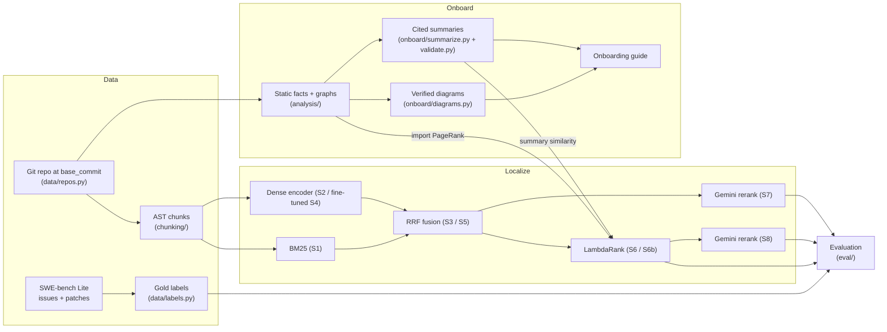

# Architecture and code map

BugLens has two modes built on **one shared index** of each repository:

- **Localize** — rank the files and functions a fix will touch (the research core).
- **Onboard** — diagrams, a cited guide and "ask the codebase" for a newcomer.

## Data flow

## Source tree (`src/buglens/`)

| Folder / file | Responsibility |
| --- | --- |
| `cli.py` | The `buglens` command (one sub-command per pipeline stage) |
| `config.py`, `schemas.py` | YAML configuration, seeds, run metadata; typed records (pydantic) |
| `data/` | Load SWE-bench, clone repos and read files at any commit, derive gold labels, leakage assertion |
| `chunking/` | Split Python files into function/class/module chunks; per-commit corpus with a blob-level cache |
| `retrieval/` | Code-aware tokenizer, BM25, dense encoder + embedding cache + FAISS, Reciprocal Rank Fusion, runner |
| `training/` | Build contrastive triples, a 60-line teaching InfoNCE loop, the fine-tuning script |
| `rerank/` | 21 reranker features; LambdaRank with leave-one-repo-out cross-validation |
| `analysis/` | AST facts, import/inheritance/call graphs, PageRank, package aggregation, entry points |
| `onboard/` | Diagram builders + verifier, Mermaid/SVG export, summaries, citation validator, guide, ask, highlight overlay |
| `llm/` | Gemini client (cache, backoff, quota stop, request cap, leakage guard), LLM reranker, patch generation |
| `eval/` | Metrics, bootstrap/McNemar statistics, report, onboarding evaluation |
| `demo/app.py` | Gradio app with the Localize and Onboard tabs |

Every module starts with a short docstring explaining the concept it implements.

## Other folders

| Folder | Content |
| --- | --- |
| `configs/` | `default.yaml` (all settings), `experiments.yaml` (systems and planned comparisons), QA questions |
| `tests/` | 70 unit tests, including a small fixture repository |
| `scripts/` | Resumable pipelines, research-report builders, screenshot helper, harness runner |
| `notebooks/` | Kaggle notebook for fine-tuning on a free cloud GPU |
| `runs/` | One JSONL file per system and split: the per-issue rankings behind every number |
| `onboarding/` | Generated diagrams, guides and summaries for flask, requests and django |
| `reports/` | Results, error analysis, onboarding evaluation, the research report and workbook |
| `docs/` | This documentation and screenshots |
| `data/` *(not in git)* | Cloned repositories, caches, indexes, the fine-tuned model (~7 GB) |

## Design principles

1. **Diagrams come only from static analysis.** `verify_diagram` re-derives every node and edge from
   the code graphs and must report 100% before a diagram is written.
2. **LLM text must be grounded.** Every sentence cites `file:line`; the validator drops sentences whose
   citations fall outside the code the model was shown.
3. **No leakage.** The gold patch and tests never reach retrieval, features or prompts; the LLM client
   checks every prompt.
4. **Reproducible.** Seeds fixed, versions pinned, every step cached and logged; `make reproduce`
   rebuilds all results from the cache with identical rankings.
