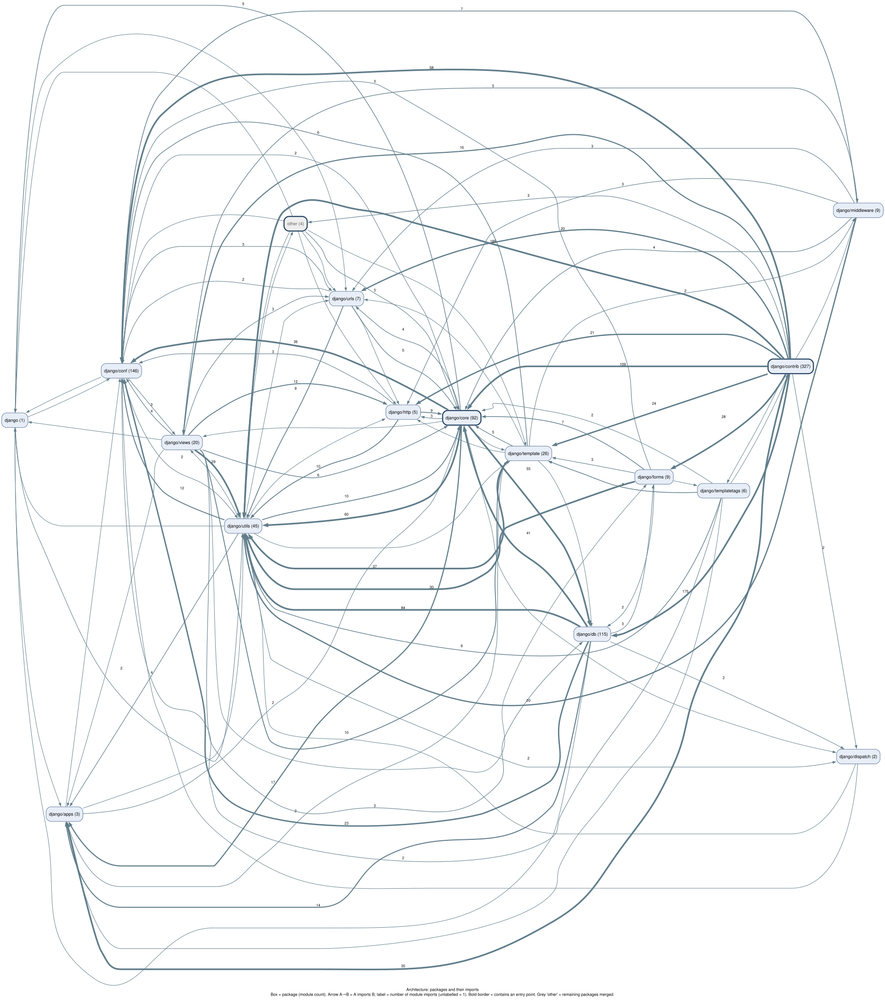
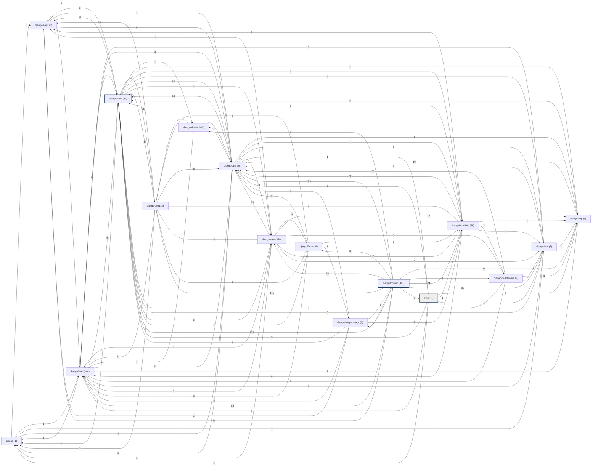

# Onboarding guide: django/django

Generated by BugLens at commit [`e7fd69d051`](https://github.com/django/django/tree/e7fd69d051eaa67cb17f172a39b57253e9cb831a). Structure is from static analysis; prose sentences are LLM-written and each is checked against the cited lines.

## 1. Overview

- The django/conf package provides configuration management through a settings class and a lazy proxy for global or custom settings. [`django/conf/__init__.py:42`](https://github.com/django/django/blob/e7fd69d051eaa67cb17f172a39b57253e9cb831a/django/conf/__init__.py#L42) [`django/conf/__init__.py:130`](https://github.com/django/django/blob/e7fd69d051eaa67cb17f172a39b57253e9cb831a/django/conf/__init__.py#L130) [`django/conf/__init__.py:186`](https://github.com/django/django/blob/e7fd69d051eaa67cb17f172a39b57253e9cb831a/django/conf/__init__.py#L186)
- The django/db package manages database connections with utilities like ConnectionHandler and provides error handling and backend loading capabilities. [`django/db/utils.py:135`](https://github.com/django/django/blob/e7fd69d051eaa67cb17f172a39b57253e9cb831a/django/db/utils.py#L135) [`django/db/utils.py:227`](https://github.com/django/django/blob/e7fd69d051eaa67cb17f172a39b57253e9cb831a/django/db/utils.py#L227) [`django/db/utils.py:51`](https://github.com/django/django/blob/e7fd69d051eaa67cb17f172a39b57253e9cb831a/django/db/utils.py#L51) [`django/db/utils.py:100`](https://github.com/django/django/blob/e7fd69d051eaa67cb17f172a39b57253e9cb831a/django/db/utils.py#L100)
- The django/urls package offers pattern resolution and matching utilities such as URLResolver, URLPattern, and RoutePattern. [`django/urls/resolvers.py:365`](https://github.com/django/django/blob/e7fd69d051eaa67cb17f172a39b57253e9cb831a/django/urls/resolvers.py#L365) [`django/urls/resolvers.py:314`](https://github.com/django/django/blob/e7fd69d051eaa67cb17f172a39b57253e9cb831a/django/urls/resolvers.py#L314) [`django/urls/resolvers.py:139`](https://github.com/django/django/blob/e7fd69d051eaa67cb17f172a39b57253e9cb831a/django/urls/resolvers.py#L139) [`django/urls/resolvers.py:237`](https://github.com/django/django/blob/e7fd69d051eaa67cb17f172a39b57253e9cb831a/django/urls/resolvers.py#L237)
- The django/http package handles HTTP requests and responses, including basic request representation and header management. [`django/http/request.py:38`](https://github.com/django/django/blob/e7fd69d051eaa67cb17f172a39b57253e9cb831a/django/http/request.py#L38) [`django/http/response.py:28`](https://github.com/django/django/blob/e7fd69d051eaa67cb17f172a39b57253e9cb831a/django/http/response.py#L28)
- The django/views package includes generic base views and debugging utilities for exception reporting and technical 404 errors. [`django/views/generic/base.py:30`](https://github.com/django/django/blob/e7fd69d051eaa67cb17f172a39b57253e9cb831a/django/views/generic/base.py#L30) [`django/views/generic/base.py:162`](https://github.com/django/django/blob/e7fd69d051eaa67cb17f172a39b57253e9cb831a/django/views/generic/base.py#L162) [`django/views/generic/base.py:153`](https://github.com/django/django/blob/e7fd69d051eaa67cb17f172a39b57253e9cb831a/django/views/generic/base.py#L153) [`django/views/debug.py:244`](https://github.com/django/django/blob/e7fd69d051eaa67cb17f172a39b57253e9cb831a/django/views/debug.py#L244) [`django/views/debug.py:48`](https://github.com/django/django/blob/e7fd69d051eaa67cb17f172a39b57253e9cb831a/django/views/debug.py#L48) [`django/views/debug.py:459`](https://github.com/django/django/blob/e7fd69d051eaa67cb17f172a39b57253e9cb831a/django/views/debug.py#L459)

## 2. Architecture

Mermaid source

## 3. Entry points

- **__main__** `django.__main__ __main__` [`django/__main__.py:8`](https://github.com/django/django/blob/e7fd69d051eaa67cb17f172a39b57253e9cb831a/django/__main__.py#L8) — [call flow](diagrams/callflow/django.__main_____main.svg)
- **__main__** `django.bin.django-admin __main__` [`django/bin/django-admin.py:4`](https://github.com/django/django/blob/e7fd69d051eaa67cb17f172a39b57253e9cb831a/django/bin/django-admin.py#L4) — [call flow](diagrams/callflow/django.bin.django-admin___main.svg)
- **__main__** `django.contrib.admin.bin.compress __main__` [`django/contrib/admin/bin/compress.py:60`](https://github.com/django/django/blob/e7fd69d051eaa67cb17f172a39b57253e9cb831a/django/contrib/admin/bin/compress.py#L60) — [call flow](diagrams/callflow/django.contrib.admin.bin.compress___main.svg)
- **console_script** `django-admin -> django.core.management:execute_from_command_line` [`django/core/management/__init__.py:378`](https://github.com/django/django/blob/e7fd69d051eaa67cb17f172a39b57253e9cb831a/django/core/management/__init__.py#L378) — [call flow](diagrams/callflow/django-admin_-_django.core.management_execute_from_command_line.svg)
- **__main__** `scripts.manage_translations __main__` [`scripts/manage_translations.py:176`](https://github.com/django/django/blob/e7fd69d051eaa67cb17f172a39b57253e9cb831a/scripts/manage_translations.py#L176) — [call flow](diagrams/callflow/scripts.manage_translations___main.svg)

## 4. Core packages

Top 10 packages by import-graph PageRank.

### `django/contrib` — [drill-down diagram](diagrams/packages/django_contrib.svg)

_No validated summary for this package._

### `django/db` — [drill-down diagram](diagrams/packages/django_db.svg)

- The django/db package provides utilities and classes such as ConnectionHandler and ConnectionRouter to manage database connections. [`django/db/utils.py:135`](https://github.com/django/django/blob/e7fd69d051eaa67cb17f172a39b57253e9cb831a/django/db/utils.py#L135) [`django/db/utils.py:227`](https://github.com/django/django/blob/e7fd69d051eaa67cb17f172a39b57253e9cb831a/django/db/utils.py#L227)
- It includes a DefaultConnectionProxy to access the default DatabaseWrapper attributes and functions to reset queries or close old connections. [`django/db/__init__.py:26`](https://github.com/django/django/blob/e7fd69d051eaa67cb17f172a39b57253e9cb831a/django/db/__init__.py#L26) [`django/db/__init__.py:49`](https://github.com/django/django/blob/e7fd69d051eaa67cb17f172a39b57253e9cb831a/django/db/__init__.py#L49) [`django/db/__init__.py:59`](https://github.com/django/django/blob/e7fd69d051eaa67cb17f172a39b57253e9cb831a/django/db/__init__.py#L59)
- Additionally, it offers backend loading capabilities and error handling wrappers for database operations. [`django/db/utils.py:51`](https://github.com/django/django/blob/e7fd69d051eaa67cb17f172a39b57253e9cb831a/django/db/utils.py#L51) [`django/db/utils.py:100`](https://github.com/django/django/blob/e7fd69d051eaa67cb17f172a39b57253e9cb831a/django/db/utils.py#L100)

### `django/utils` — [drill-down diagram](diagrams/packages/django_utils.svg)

- The django/utils package provides helper functions and utilities such as lazy evaluation tools and decorators. [`django/utils/functional.py:60`](https://github.com/django/django/blob/e7fd69d051eaa67cb17f172a39b57253e9cb831a/django/utils/functional.py#L60) [`django/utils/functional.py:189`](https://github.com/django/django/blob/e7fd69d051eaa67cb17f172a39b57253e9cb831a/django/utils/functional.py#L189)

### `django/core` — [drill-down diagram](diagrams/packages/django_core.svg)

- The django/core package contains modules for handling core exceptions such as data validation errors and suspicious operations. [`django/core/exceptions.py:94`](https://github.com/django/django/blob/e7fd69d051eaa67cb17f172a39b57253e9cb831a/django/core/exceptions.py#L94) [`django/core/exceptions.py:50`](https://github.com/django/django/blob/e7fd69d051eaa67cb17f172a39b57253e9cb831a/django/core/exceptions.py#L50)
- It defines specific exceptions for situations where requested objects do not exist or when multiple objects are returned unexpectedly. [`django/core/exceptions.py:16`](https://github.com/django/django/blob/e7fd69d051eaa67cb17f172a39b57253e9cb831a/django/core/exceptions.py#L16) [`django/core/exceptions.py:21`](https://github.com/django/django/blob/e7fd69d051eaa67cb17f172a39b57253e9cb831a/django/core/exceptions.py#L21)

### `django/conf` — [drill-down diagram](diagrams/packages/django_conf.svg)

- The django/conf package provides a lazy proxy for either global Django settings or a custom settings object. [`django/conf/__init__.py:42`](https://github.com/django/django/blob/e7fd69d051eaa67cb17f172a39b57253e9cb831a/django/conf/__init__.py#L42)
- It also defines a settings class and a holder for user configured settings. [`django/conf/__init__.py:130`](https://github.com/django/django/blob/e7fd69d051eaa67cb17f172a39b57253e9cb831a/django/conf/__init__.py#L130) [`django/conf/__init__.py:186`](https://github.com/django/django/blob/e7fd69d051eaa67cb17f172a39b57253e9cb831a/django/conf/__init__.py#L186)

### `django/apps` — [drill-down diagram](diagrams/packages/django_apps.svg)

- The django/apps package includes components representing a Django application and its configuration. [`django/apps/config.py:10`](https://github.com/django/django/blob/e7fd69d051eaa67cb17f172a39b57253e9cb831a/django/apps/config.py#L10)
- It also provides a registry that stores the configuration of installed applications. [`django/apps/registry.py:13`](https://github.com/django/django/blob/e7fd69d051eaa67cb17f172a39b57253e9cb831a/django/apps/registry.py#L13)

### `django/template` — [drill-down diagram](diagrams/packages/django_template.svg)

- The template package provides tools such as Template for handling templates and Variable for resolvable template variables against a given context. [`django/template/base.py:141`](https://github.com/django/django/blob/e7fd69d051eaa67cb17f172a39b57253e9cb831a/django/template/base.py#L141) [`django/template/base.py:727`](https://github.com/django/django/blob/e7fd69d051eaa67cb17f172a39b57253e9cb831a/django/template/base.py#L727)
- It also defines parsing components including Parser, Lexer, and Node to process template tokens and expressions. [`django/template/base.py:409`](https://github.com/django/django/blob/e7fd69d051eaa67cb17f172a39b57253e9cb831a/django/template/base.py#L409) [`django/template/base.py:333`](https://github.com/django/django/blob/e7fd69d051eaa67cb17f172a39b57253e9cb831a/django/template/base.py#L333) [`django/template/base.py:883`](https://github.com/django/django/blob/e7fd69d051eaa67cb17f172a39b57253e9cb831a/django/template/base.py#L883)

### `django/dispatch` — [drill-down diagram](diagrams/packages/django_dispatch.svg)

- The django/dispatch package provides the Signal base class for all signals in the repository. [`django/dispatch/dispatcher.py:19`](https://github.com/django/django/blob/e7fd69d051eaa67cb17f172a39b57253e9cb831a/django/dispatch/dispatcher.py#L19)
- It also provides a receiver decorator used for connecting receivers to signals. [`django/dispatch/dispatcher.py:272`](https://github.com/django/django/blob/e7fd69d051eaa67cb17f172a39b57253e9cb831a/django/dispatch/dispatcher.py#L272)

### `django/urls` — [drill-down diagram](diagrams/packages/django_urls.svg)

- The django/urls package includes pattern resolution classes such as URLResolver and URLPattern. [`django/urls/resolvers.py:365`](https://github.com/django/django/blob/e7fd69d051eaa67cb17f172a39b57253e9cb831a/django/urls/resolvers.py#L365) [`django/urls/resolvers.py:314`](https://github.com/django/django/blob/e7fd69d051eaa67cb17f172a39b57253e9cb831a/django/urls/resolvers.py#L314)
- It also provides pattern matching and conversion utilities like RegexPattern andRoutePattern. [`django/urls/resolvers.py:139`](https://github.com/django/django/blob/e7fd69d051eaa67cb17f172a39b57253e9cb831a/django/urls/resolvers.py#L139) [`django/urls/resolvers.py:237`](https://github.com/django/django/blob/e7fd69d051eaa67cb17f172a39b57253e9cb831a/django/urls/resolvers.py#L237)

### `django/http` — [drill-down diagram](diagrams/packages/django_http.svg)

- The package provides classes such as HttpRequest representing a basic HTTP request and HttpResponseBase serving as an HTTP response base class with dictionary-accessed headers. [`django/http/request.py:38`](https://github.com/django/django/blob/e7fd69d051eaa67cb17f172a39b57253e9cb831a/django/http/request.py#L38) [`django/http/response.py:28`](https://github.com/django/django/blob/e7fd69d051eaa67cb17f172a39b57253e9cb831a/django/http/response.py#L28)
- It also includes utilities like parse_cookie to parse a Cookie header string into a dictionary. [`django/http/cookie.py:10`](https://github.com/django/django/blob/e7fd69d051eaa67cb17f172a39b57253e9cb831a/django/http/cookie.py#L10)

## 5. Key classes

Top 10 classes by number of in-repo subclasses.

| Class | Subclasses | Defined at | Diagram |
| --- | --- | --- | --- |
| `Node` | 45 | [`django/template/base.py:883`](https://github.com/django/django/blob/e7fd69d051eaa67cb17f172a39b57253e9cb831a/django/template/base.py#L883) | [classes of django.template.base](diagrams/classes/django.template.base.svg) |
| `Func` | 41 | [`django/db/models/expressions.py:557`](https://github.com/django/django/blob/e7fd69d051eaa67cb17f172a39b57253e9cb831a/django/db/models/expressions.py#L557) | [classes of django.db.models.expressions](diagrams/classes/django.db.models.expressions.svg) |
| `Transform` | 39 | [`django/db/models/lookups.py:129`](https://github.com/django/django/blob/e7fd69d051eaa67cb17f172a39b57253e9cb831a/django/db/models/lookups.py#L129) | [classes of django.db.models.lookups](diagrams/classes/django.db.models.lookups.svg) |
| `BaseCommand` | 31 | [`django/core/management/base.py:148`](https://github.com/django/django/blob/e7fd69d051eaa67cb17f172a39b57253e9cb831a/django/core/management/base.py#L148) | [classes of django.core.management.base](diagrams/classes/django.core.management.base.svg) |
| `GISLookup` | 25 | [`django/contrib/gis/db/models/lookups.py:14`](https://github.com/django/django/blob/e7fd69d051eaa67cb17f172a39b57253e9cb831a/django/contrib/gis/db/models/lookups.py#L14) | [classes of django.contrib.gis.db.models.lookups](diagrams/classes/django.contrib.gis.db.models.lookups.svg) |
| `Migration` | 21 | [`django/db/migrations/migration.py:6`](https://github.com/django/django/blob/e7fd69d051eaa67cb17f172a39b57253e9cb831a/django/db/migrations/migration.py#L6) | [classes of django.db.migrations.migration](diagrams/classes/django.db.migrations.migration.svg) |
| `NumericOutputFieldMixin` | 20 | [`django/db/models/functions/mixins.py:42`](https://github.com/django/django/blob/e7fd69d051eaa67cb17f172a39b57253e9cb831a/django/db/models/functions/mixins.py#L42) | [classes of django.db.models.functions.mixins](diagrams/classes/django.db.models.functions.mixins.svg) |
| `Field` | 19 | [`django/db/models/fields/__init__.py:88`](https://github.com/django/django/blob/e7fd69d051eaa67cb17f172a39b57253e9cb831a/django/db/models/fields/__init__.py#L88) | [classes of django.db.models.fields](diagrams/classes/django.db.models.fields.svg) |
| `MiddlewareMixin` | 19 | [`django/utils/deprecation.py:85`](https://github.com/django/django/blob/e7fd69d051eaa67cb17f172a39b57253e9cb831a/django/utils/deprecation.py#L85) | [classes of django.utils.deprecation](diagrams/classes/django.utils.deprecation.svg) |
| `GeoFunc` | 17 | [`django/contrib/gis/db/models/functions.py:88`](https://github.com/django/django/blob/e7fd69d051eaa67cb17f172a39b57253e9cb831a/django/contrib/gis/db/models/functions.py#L88) | [classes of django.contrib.gis.db.models.functions](diagrams/classes/django.contrib.gis.db.models.functions.svg) |

## 6. First 5 files to read

Most central modules (PageRank) reachable from the entry points.

1. [`django/conf/__init__.py`](https://github.com/django/django/blob/e7fd69d051eaa67cb17f172a39b57253e9cb831a/django/conf/__init__.py#L1) — `django.conf`
2. [`django/core/exceptions.py`](https://github.com/django/django/blob/e7fd69d051eaa67cb17f172a39b57253e9cb831a/django/core/exceptions.py#L1) — `django.core.exceptions`
3. [`django/utils/functional.py`](https://github.com/django/django/blob/e7fd69d051eaa67cb17f172a39b57253e9cb831a/django/utils/functional.py#L1) — `django.utils.functional`
4. [`django/apps/__init__.py`](https://github.com/django/django/blob/e7fd69d051eaa67cb17f172a39b57253e9cb831a/django/apps/__init__.py#L1) — `django.apps`
5. [`django/utils/deprecation.py`](https://github.com/django/django/blob/e7fd69d051eaa67cb17f172a39b57253e9cb831a/django/utils/deprecation.py#L1) — `django.utils.deprecation`

## 7. Glossary

Most frequent name parts across class/function names (no LLM), each with a representative definition.

| Term | Names using it | Definition |
| --- | --- | --- |
| **field** | 313 | `Field` (class) [`django/db/models/fields/__init__.py:88`](https://github.com/django/django/blob/e7fd69d051eaa67cb17f172a39b57253e9cb831a/django/db/models/fields/__init__.py#L88) |
| **check** | 285 | `DeprecationInstanceCheck` (class) [`django/utils/deprecation.py:76`](https://github.com/django/django/blob/e7fd69d051eaa67cb17f172a39b57253e9cb831a/django/utils/deprecation.py#L76) |
| **sql** | 250 | `RawSQL` (class) [`django/db/models/expressions.py:683`](https://github.com/django/django/blob/e7fd69d051eaa67cb17f172a39b57253e9cb831a/django/db/models/expressions.py#L683) |
| **add** | 151 | `AddIndex` (class) [`django/db/migrations/operations/models.py:724`](https://github.com/django/django/blob/e7fd69d051eaa67cb17f172a39b57253e9cb831a/django/db/migrations/operations/models.py#L724) |
| **model** | 127 | `Model` (class) [`django/db/models/base.py:394`](https://github.com/django/django/blob/e7fd69d051eaa67cb17f172a39b57253e9cb831a/django/db/models/base.py#L394) |
| **database** | 124 | `DatabaseError` (class) [`django/db/utils.py:23`](https://github.com/django/django/blob/e7fd69d051eaa67cb17f172a39b57253e9cb831a/django/db/utils.py#L23) |
| **type** | 117 | `PositiveIntegerRelDbTypeMixin` (class) [`django/db/models/fields/__init__.py:1981`](https://github.com/django/django/blob/e7fd69d051eaa67cb17f172a39b57253e9cb831a/django/db/models/fields/__init__.py#L1981) |
| **lookup** | 99 | `Lookup` (class) [`django/db/models/lookups.py:13`](https://github.com/django/django/blob/e7fd69d051eaa67cb17f172a39b57253e9cb831a/django/db/models/lookups.py#L13) |
| **key** | 98 | `MultiValueDictKeyError` (class) [`django/utils/datastructures.py:38`](https://github.com/django/django/blob/e7fd69d051eaa67cb17f172a39b57253e9cb831a/django/utils/datastructures.py#L38) |
| **list** | 95 | `ExpressionList` (class) [`django/db/models/expressions.py:816`](https://github.com/django/django/blob/e7fd69d051eaa67cb17f172a39b57253e9cb831a/django/db/models/expressions.py#L816) |
| **create** | 90 | `CreateModel` (class) [`django/db/migrations/operations/models.py:41`](https://github.com/django/django/blob/e7fd69d051eaa67cb17f172a39b57253e9cb831a/django/db/migrations/operations/models.py#L41) |
| **form** | 82 | `Form` (class) [`django/forms/forms.py:494`](https://github.com/django/django/blob/e7fd69d051eaa67cb17f172a39b57253e9cb831a/django/forms/forms.py#L494) |
| **fields** | 81 | `TooManyFieldsSent` (class) [`django/core/exceptions.py:50`](https://github.com/django/django/blob/e7fd69d051eaa67cb17f172a39b57253e9cb831a/django/core/exceptions.py#L50) |
| **render** | 80 | `RenderContext` (class) [`django/template/context.py:172`](https://github.com/django/django/blob/e7fd69d051eaa67cb17f172a39b57253e9cb831a/django/template/context.py#L172) |
| **handle** | 79 | `GEOSContextHandle_t` (class) [`django/contrib/gis/geos/libgeos.py:120`](https://github.com/django/django/blob/e7fd69d051eaa67cb17f172a39b57253e9cb831a/django/contrib/gis/geos/libgeos.py#L120) |
| **date** | 78 | `date` (class) [`django/utils/datetime_safe.py:17`](https://github.com/django/django/blob/e7fd69d051eaa67cb17f172a39b57253e9cb831a/django/utils/datetime_safe.py#L17) |
| **view** | 78 | `View` (class) [`django/views/generic/base.py:30`](https://github.com/django/django/blob/e7fd69d051eaa67cb17f172a39b57253e9cb831a/django/views/generic/base.py#L30) |
| **delete** | 74 | `DeleteModel` (class) [`django/db/migrations/operations/models.py:242`](https://github.com/django/django/blob/e7fd69d051eaa67cb17f172a39b57253e9cb831a/django/db/migrations/operations/models.py#L242) |
| **related** | 71 | `RelatedField` (class) [`django/db/models/fields/related.py:83`](https://github.com/django/django/blob/e7fd69d051eaa67cb17f172a39b57253e9cb831a/django/db/models/fields/related.py#L83) |
| **error** | 70 | `Error` (class) [`django/db/utils.py:15`](https://github.com/django/django/blob/e7fd69d051eaa67cb17f172a39b57253e9cb831a/django/db/utils.py#L15) |

## 8. Generation stats

- Commit: `e7fd69d051eaa67cb17f172a39b57253e9cb831a`
- Files analysed: 817 (parse failures: 0)
- Import graph: 817 modules, 2553 edges
- Inheritance graph: 1654 classes, 1313 edges
- Call graph: 9609 nodes, 6319 resolved edges, 13565 unresolved calls
- Diagrams: 31 generated, 100.0% of nodes/edges verified against the graphs
- Summary sentences: 33 kept, 1 dropped by the citation validator (model: gemini-3.5-flash-lite)
