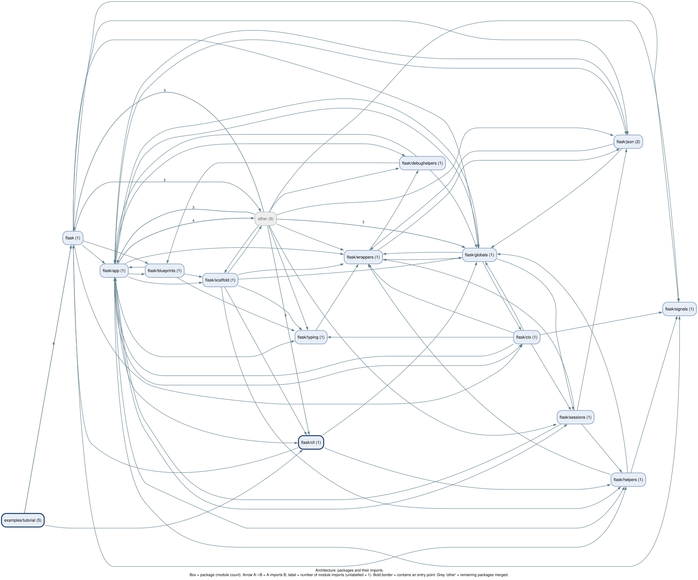
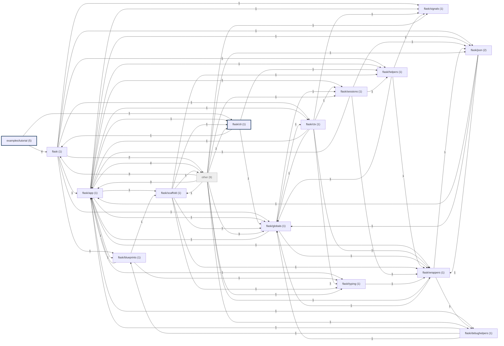

# Onboarding guide: pallets/flask

Generated by BugLens at commit [`d8c37f4372`](https://github.com/pallets/flask/tree/d8c37f43724cd9fb0870f77877b7c4c7e38a19e0). Structure is from static analysis; prose sentences are LLM-written and each is checked against the cited lines.

## 1. Overview

_No validated overview yet (run `buglens summarize` with a Gemini key)._

## 2. Architecture

Mermaid source

## 3. Entry points

- **cli** `init_db_command (@click.command)` [`examples/tutorial/flaskr/db.py:41`](https://github.com/pallets/flask/blob/d8c37f43724cd9fb0870f77877b7c4c7e38a19e0/examples/tutorial/flaskr/db.py#L41) — [call flow](diagrams/callflow/init_db_command_click.command.svg)
- **cli** `run_command (@click.command)` [`src/flask/cli.py:779`](https://github.com/pallets/flask/blob/d8c37f43724cd9fb0870f77877b7c4c7e38a19e0/src/flask/cli.py#L779) — [call flow](diagrams/callflow/run_command_click.command.svg)
- **cli** `shell_command (@click.command)` [`src/flask/cli.py:861`](https://github.com/pallets/flask/blob/d8c37f43724cd9fb0870f77877b7c4c7e38a19e0/src/flask/cli.py#L861) — [call flow](diagrams/callflow/shell_command_click.command.svg)
- **cli** `routes_command (@click.command)` [`src/flask/cli.py:912`](https://github.com/pallets/flask/blob/d8c37f43724cd9fb0870f77877b7c4c7e38a19e0/src/flask/cli.py#L912) — [call flow](diagrams/callflow/routes_command_click.command.svg)
- **console_script** `flask -> flask.cli:main` [`src/flask/cli.py:981`](https://github.com/pallets/flask/blob/d8c37f43724cd9fb0870f77877b7c4c7e38a19e0/src/flask/cli.py#L981) — [call flow](diagrams/callflow/flask_-_flask.cli_main.svg)
- **__main__** `flask.cli __main__` [`src/flask/cli.py:993`](https://github.com/pallets/flask/blob/d8c37f43724cd9fb0870f77877b7c4c7e38a19e0/src/flask/cli.py#L993) — [call flow](diagrams/callflow/flask.cli___main.svg)

## 4. Core packages

Top 10 packages by import-graph PageRank.

### `flask/globals` — [drill-down diagram](diagrams/packages/flask_globals.svg)

_No validated summary for this package._

### `flask/wrappers` — [drill-down diagram](diagrams/packages/flask_wrappers.svg)

_No validated summary for this package._

### `flask/app` — [drill-down diagram](diagrams/packages/flask_app.svg)

_No validated summary for this package._

### `flask/json` — [drill-down diagram](diagrams/packages/flask_json.svg)

_No validated summary for this package._

### `flask/debughelpers` — [drill-down diagram](diagrams/packages/flask_debughelpers.svg)

_No validated summary for this package._

### `flask` — [drill-down diagram](diagrams/packages/flask.svg)

_No validated summary for this package._

### `flask/sessions` — [drill-down diagram](diagrams/packages/flask_sessions.svg)

_No validated summary for this package._

### `flask/ctx` — [drill-down diagram](diagrams/packages/flask_ctx.svg)

_No validated summary for this package._

### `flask/helpers` — [drill-down diagram](diagrams/packages/flask_helpers.svg)

_No validated summary for this package._

### `flask/signals` — [drill-down diagram](diagrams/packages/flask_signals.svg)

_No validated summary for this package._

## 5. Key classes

Top 10 classes by number of in-repo subclasses.

| Class | Subclasses | Defined at | Diagram |
| --- | --- | --- | --- |
| `JSONTag` | 8 | [`src/flask/json/tag.py:57`](https://github.com/pallets/flask/blob/d8c37f43724cd9fb0870f77877b7c4c7e38a19e0/src/flask/json/tag.py#L57) | [classes of flask.json.tag](diagrams/classes/flask.json.tag.svg) |
| `Scaffold` | 2 | [`src/flask/scaffold.py:59`](https://github.com/pallets/flask/blob/d8c37f43724cd9fb0870f77877b7c4c7e38a19e0/src/flask/scaffold.py#L59) | [classes of flask.scaffold](diagrams/classes/flask.scaffold.svg) |
| `AppGroup` | 1 | [`src/flask/cli.py:445`](https://github.com/pallets/flask/blob/d8c37f43724cd9fb0870f77877b7c4c7e38a19e0/src/flask/cli.py#L445) | [classes of flask.cli](diagrams/classes/flask.cli.svg) |
| `SecureCookieSession` | 1 | [`src/flask/sessions.py:48`](https://github.com/pallets/flask/blob/d8c37f43724cd9fb0870f77877b7c4c7e38a19e0/src/flask/sessions.py#L48) | [classes of flask.sessions](diagrams/classes/flask.sessions.svg) |
| `SessionInterface` | 1 | [`src/flask/sessions.py:107`](https://github.com/pallets/flask/blob/d8c37f43724cd9fb0870f77877b7c4c7e38a19e0/src/flask/sessions.py#L107) | [classes of flask.sessions](diagrams/classes/flask.sessions.svg) |
| `SessionMixin` | 1 | [`src/flask/sessions.py:20`](https://github.com/pallets/flask/blob/d8c37f43724cd9fb0870f77877b7c4c7e38a19e0/src/flask/sessions.py#L20) | [classes of flask.sessions](diagrams/classes/flask.sessions.svg) |
| `View` | 1 | [`src/flask/views.py:12`](https://github.com/pallets/flask/blob/d8c37f43724cd9fb0870f77877b7c4c7e38a19e0/src/flask/views.py#L12) | [classes of flask.views](diagrams/classes/flask.views.svg) |
| `Flask` | 0 | [`src/flask/app.py:101`](https://github.com/pallets/flask/blob/d8c37f43724cd9fb0870f77877b7c4c7e38a19e0/src/flask/app.py#L101) | [classes of flask.app](diagrams/classes/flask.app.svg) |
| `Blueprint` | 0 | [`src/flask/blueprints.py:108`](https://github.com/pallets/flask/blob/d8c37f43724cd9fb0870f77877b7c4c7e38a19e0/src/flask/blueprints.py#L108) | [classes of flask.blueprints](diagrams/classes/flask.blueprints.svg) |
| `BlueprintSetupState` | 0 | [`src/flask/blueprints.py:25`](https://github.com/pallets/flask/blob/d8c37f43724cd9fb0870f77877b7c4c7e38a19e0/src/flask/blueprints.py#L25) | [classes of flask.blueprints](diagrams/classes/flask.blueprints.svg) |

## 6. First 5 files to read

Most central modules (PageRank) reachable from the entry points.

1. [`src/flask/globals.py`](https://github.com/pallets/flask/blob/d8c37f43724cd9fb0870f77877b7c4c7e38a19e0/src/flask/globals.py#L1) — `flask.globals`
2. [`src/flask/wrappers.py`](https://github.com/pallets/flask/blob/d8c37f43724cd9fb0870f77877b7c4c7e38a19e0/src/flask/wrappers.py#L1) — `flask.wrappers`
3. [`src/flask/app.py`](https://github.com/pallets/flask/blob/d8c37f43724cd9fb0870f77877b7c4c7e38a19e0/src/flask/app.py#L1) — `flask.app`
4. [`src/flask/json/__init__.py`](https://github.com/pallets/flask/blob/d8c37f43724cd9fb0870f77877b7c4c7e38a19e0/src/flask/json/__init__.py#L1) — `flask.json`
5. [`src/flask/debughelpers.py`](https://github.com/pallets/flask/blob/d8c37f43724cd9fb0870f77877b7c4c7e38a19e0/src/flask/debughelpers.py#L1) — `flask.debughelpers`

## 7. Glossary

Most frequent name parts across class/function names (no LLM), each with a representative definition.

| Term | Names using it | Definition |
| --- | --- | --- |
| **app** | 31 | `_AppCtxGlobals` (class) [`src/flask/ctx.py:24`](https://github.com/pallets/flask/blob/d8c37f43724cd9fb0870f77877b7c4c7e38a19e0/src/flask/ctx.py#L24) |
| **request** | 26 | `Request` (class) [`src/flask/wrappers.py:15`](https://github.com/pallets/flask/blob/d8c37f43724cd9fb0870f77877b7c4c7e38a19e0/src/flask/wrappers.py#L15) |
| **template** | 18 | `update_template_context` (method) [`src/flask/app.py:734`](https://github.com/pallets/flask/blob/d8c37f43724cd9fb0870f77877b7c4c7e38a19e0/src/flask/app.py#L734) |
| **context** | 15 | `AppContext` (class) [`src/flask/ctx.py:219`](https://github.com/pallets/flask/blob/d8c37f43724cd9fb0870f77877b7c4c7e38a19e0/src/flask/ctx.py#L219) |
| **json** | 15 | `JSONEncoder` (class) [`src/flask/json/__init__.py:25`](https://github.com/pallets/flask/blob/d8c37f43724cd9fb0870f77877b7c4c7e38a19e0/src/flask/json/__init__.py#L25) |
| **url** | 14 | `add_url_rule` (method) [`src/flask/app.py:1032`](https://github.com/pallets/flask/blob/d8c37f43724cd9fb0870f77877b7c4c7e38a19e0/src/flask/app.py#L1032) |
| **session** | 12 | `SessionMixin` (class) [`src/flask/sessions.py:20`](https://github.com/pallets/flask/blob/d8c37f43724cd9fb0870f77877b7c4c7e38a19e0/src/flask/sessions.py#L20) |
| **add** | 11 | `add_url_rule` (method) [`src/flask/app.py:1032`](https://github.com/pallets/flask/blob/d8c37f43724cd9fb0870f77877b7c4c7e38a19e0/src/flask/app.py#L1032) |
| **cookie** | 10 | `SecureCookieSession` (class) [`src/flask/sessions.py:48`](https://github.com/pallets/flask/blob/d8c37f43724cd9fb0870f77877b7c4c7e38a19e0/src/flask/sessions.py#L48) |
| **load** | 10 | `_load_form_data` (method) [`src/flask/wrappers.py:80`](https://github.com/pallets/flask/blob/d8c37f43724cd9fb0870f77877b7c4c7e38a19e0/src/flask/wrappers.py#L80) |
| **check** | 9 | `check` (method) [`src/flask/json/tag.py:70`](https://github.com/pallets/flask/blob/d8c37f43724cd9fb0870f77877b7c4c7e38a19e0/src/flask/json/tag.py#L70) |
| **exception** | 9 | `NoAppException` (class) [`src/flask/cli.py:33`](https://github.com/pallets/flask/blob/d8c37f43724cd9fb0870f77877b7c4c7e38a19e0/src/flask/cli.py#L33) |
| **tag** | 9 | `JSONTag` (class) [`src/flask/json/tag.py:57`](https://github.com/pallets/flask/blob/d8c37f43724cd9fb0870f77877b7c4c7e38a19e0/src/flask/json/tag.py#L57) |
| **make** | 8 | `_make_timedelta` (function) [`src/flask/app.py:94`](https://github.com/pallets/flask/blob/d8c37f43724cd9fb0870f77877b7c4c7e38a19e0/src/flask/app.py#L94) |
| **path** | 8 | `SeparatedPathType` (class) [`src/flask/cli.py:767`](https://github.com/pallets/flask/blob/d8c37f43724cd9fb0870f77877b7c4c7e38a19e0/src/flask/cli.py#L767) |
| **error** | 7 | `UnexpectedUnicodeError` (class) [`src/flask/debughelpers.py:10`](https://github.com/pallets/flask/blob/d8c37f43724cd9fb0870f77877b7c4c7e38a19e0/src/flask/debughelpers.py#L10) |
| **find** | 7 | `_find_app` (function) [`src/flask/globals.py:44`](https://github.com/pallets/flask/blob/d8c37f43724cd9fb0870f77877b7c4c7e38a19e0/src/flask/globals.py#L44) |
| **python** | 7 | `to_python` (method) [`src/flask/json/tag.py:79`](https://github.com/pallets/flask/blob/d8c37f43724cd9fb0870f77877b7c4c7e38a19e0/src/flask/json/tag.py#L79) |
| **command** | 6 | `command` (method) [`src/flask/cli.py:453`](https://github.com/pallets/flask/blob/d8c37f43724cd9fb0870f77877b7c4c7e38a19e0/src/flask/cli.py#L453) |
| **create** | 6 | `create_jinja_environment` (method) [`src/flask/app.py:676`](https://github.com/pallets/flask/blob/d8c37f43724cd9fb0870f77877b7c4c7e38a19e0/src/flask/app.py#L676) |

## 8. Generation stats

- Commit: `d8c37f43724cd9fb0870f77877b7c4c7e38a19e0`
- Files analysed: 29 (parse failures: 0)
- Import graph: 29 modules, 88 edges
- Inheritance graph: 47 classes, 15 edges
- Call graph: 413 nodes, 213 resolved edges, 723 unresolved calls
- Diagrams: 32 generated, 100.0% of nodes/edges verified against the graphs
- Summary sentences: 0 kept, 0 dropped by the citation validator (model: n/a)
