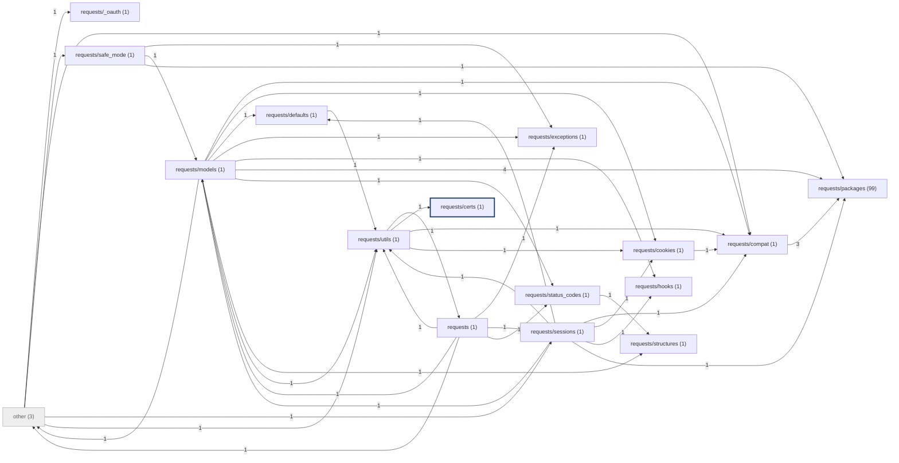

# Onboarding guide: psf/requests

Generated by BugLens at commit [`a0df2cbb10`](https://github.com/psf/requests/tree/a0df2cbb10419037d11d04352b3175405ab52941). Structure is from static analysis; prose sentences are LLM-written and each is checked against the cited lines.

## 1. Overview

- The repository includes core components like the Request and Response objects defined in the models module. [`requests/models.py:43`](https://github.com/psf/requests/blob/a0df2cbb10419037d11d04352b3175405ab52941/requests/models.py#L43) [`requests/models.py:665`](https://github.com/psf/requests/blob/a0df2cbb10419037d11d04352b3175405ab52941/requests/models.py#L665)
- The api module provides methods to send various HTTP requests such as GET, POST, and DELETE, which return Response objects. [`requests/api.py:57`](https://github.com/psf/requests/blob/a0df2cbb10419037d11d04352b3175405ab52941/requests/api.py#L57)
- Developers can utilize the Session class for context-management and handling requests sessions. [`requests/sessions.py:56`](https://github.com/psf/requests/blob/a0df2cbb10419037d11d04352b3175405ab52941/requests/sessions.py#L56) [`requests/sessions.py:325`](https://github.com/psf/requests/blob/a0df2cbb10419037d11d04352b3175405ab52941/requests/sessions.py#L325)
- The package also provides utilities for managing cookies through RequestsCookieJar, handling custom structures, and executing authentication methods. [`requests/structures.py:12`](https://github.com/psf/requests/blob/a0df2cbb10419037d11d04352b3175405ab52941/requests/structures.py#L12) [`requests/cookies.py:134`](https://github.com/psf/requests/blob/a0df2cbb10419037d11d04352b3175405ab52941/requests/cookies.py#L134) [`requests/auth.py:45`](https://github.com/psf/requests/blob/a0df2cbb10419037d11d04352b3175405ab52941/requests/auth.py#L45)
- Additionally, it includes modules for handling connection exceptions, timeouts, header utilities, and safe-mode exception catching. [`requests/utils.py:166`](https://github.com/psf/requests/blob/a0df2cbb10419037d11d04352b3175405ab52941/requests/utils.py#L166) [`requests/utils.py:197`](https://github.com/psf/requests/blob/a0df2cbb10419037d11d04352b3175405ab52941/requests/utils.py#L197) [`requests/utils.py:255`](https://github.com/psf/requests/blob/a0df2cbb10419037d11d04352b3175405ab52941/requests/utils.py#L255) [`requests/utils.py:74`](https://github.com/psf/requests/blob/a0df2cbb10419037d11d04352b3175405ab52941/requests/utils.py#L74) [`requests/exceptions.py:22`](https://github.com/psf/requests/blob/a0df2cbb10419037d11d04352b3175405ab52941/requests/exceptions.py#L22) [`requests/exceptions.py:30`](https://github.com/psf/requests/blob/a0df2cbb10419037d11d04352b3175405ab52941/requests/exceptions.py#L30) [`requests/exceptions.py:34`](https://github.com/psf/requests/blob/a0df2cbb10419037d11d04352b3175405ab52941/requests/exceptions.py#L34) [`requests/exceptions.py:38`](https://github.com/psf/requests/blob/a0df2cbb10419037d11d04352b3175405ab52941/requests/exceptions.py#L38) [`requests/exceptions.py:42`](https://github.com/psf/requests/blob/a0df2cbb10419037d11d04352b3175405ab52941/requests/exceptions.py#L42) [`requests/exceptions.py:50`](https://github.com/psf/requests/blob/a0df2cbb10419037d11d04352b3175405ab52941/requests/exceptions.py#L50) [`requests/safe_mode.py:20`](https://github.com/psf/requests/blob/a0df2cbb10419037d11d04352b3175405ab52941/requests/safe_mode.py#L20)

## 2. Architecture

Mermaid source

## 3. Entry points

- **__main__** `requests.certs __main__` [`requests/certs.py:26`](https://github.com/psf/requests/blob/a0df2cbb10419037d11d04352b3175405ab52941/requests/certs.py#L26) — [call flow](diagrams/callflow/requests.certs___main.svg)

## 4. Core packages

Top 10 packages by import-graph PageRank.

### `requests/packages` — [drill-down diagram](diagrams/packages/requests_packages.svg)

- The requests.packages package includes modules such as requests.packages.chardet, requests.packages.chardet2, and urllib3 packages like six.py. [`requests/packages/urllib3/packages/six.py:63`](https://github.com/psf/requests/blob/a0df2cbb10419037d11d04352b3175405ab52941/requests/packages/urllib3/packages/six.py#L63)

### `requests/compat` — [drill-down diagram](diagrams/packages/requests_compat.svg)

_No validated summary for this package._

### `requests/utils` — [drill-down diagram](diagrams/packages/requests_utils.svg)

- The requests/utils module provides helper functions for tasks such as parsing list and dictionary headers, expanding headers, and handling netrc authentication. [`requests/utils.py:166`](https://github.com/psf/requests/blob/a0df2cbb10419037d11d04352b3175405ab52941/requests/utils.py#L166) [`requests/utils.py:197`](https://github.com/psf/requests/blob/a0df2cbb10419037d11d04352b3175405ab52941/requests/utils.py#L197) [`requests/utils.py:255`](https://github.com/psf/requests/blob/a0df2cbb10419037d11d04352b3175405ab52941/requests/utils.py#L255) [`requests/utils.py:74`](https://github.com/psf/requests/blob/a0df2cbb10419037d11d04352b3175405ab52941/requests/utils.py#L74)
- It also includes utilities to retrieve unicode content from responses, stream decompress compressed data, unquote header values, and return the default user agent. [`requests/utils.py:391`](https://github.com/psf/requests/blob/a0df2cbb10419037d11d04352b3175405ab52941/requests/utils.py#L391) [`requests/utils.py:424`](https://github.com/psf/requests/blob/a0df2cbb10419037d11d04352b3175405ab52941/requests/utils.py#L424) [`requests/utils.py:231`](https://github.com/psf/requests/blob/a0df2cbb10419037d11d04352b3175405ab52941/requests/utils.py#L231) [`requests/utils.py:522`](https://github.com/psf/requests/blob/a0df2cbb10419037d11d04352b3175405ab52941/requests/utils.py#L522)

### `requests/structures` — [drill-down diagram](diagrams/packages/requests_structures.svg)

- The requests/structures package contains the CaseInsensitiveDict class, which provides a case-insensitive dictionary implementation. [`requests/structures.py:12`](https://github.com/psf/requests/blob/a0df2cbb10419037d11d04352b3175405ab52941/requests/structures.py#L12)
- It also defines the LookupDict class, acting as a dictionary lookup object. [`requests/structures.py:51`](https://github.com/psf/requests/blob/a0df2cbb10419037d11d04352b3175405ab52941/requests/structures.py#L51)

### `requests/cookies` — [drill-down diagram](diagrams/packages/requests_cookies.svg)

- The requests/cookies package provides a compatibility class called RequestsCookieJar that acts as a cookielib.CookieJar while exposing a dictionary interface. [`requests/cookies.py:134`](https://github.com/psf/requests/blob/a0df2cbb10419037d11d04352b3175405ab52941/requests/cookies.py#L134)
- It includes utility functions to create, extract, remove, and convert cookies, as well as handle cookie headers and dictionary conversions. [`requests/cookies.py:92`](https://github.com/psf/requests/blob/a0df2cbb10419037d11d04352b3175405ab52941/requests/cookies.py#L92) [`requests/cookies.py:302`](https://github.com/psf/requests/blob/a0df2cbb10419037d11d04352b3175405ab52941/requests/cookies.py#L302)

### `requests/models` — [drill-down diagram](diagrams/packages/requests_models.svg)

- The requests/models module defines the Request object, which carries out all request functionality. [`requests/models.py:43`](https://github.com/psf/requests/blob/a0df2cbb10419037d11d04352b3175405ab52941/requests/models.py#L43)
- It also defines the core Response object. [`requests/models.py:665`](https://github.com/psf/requests/blob/a0df2cbb10419037d11d04352b3175405ab52941/requests/models.py#L665)

### `requests/exceptions` — [drill-down diagram](diagrams/packages/requests_exceptions.svg)

- The requests/exceptions module defines RequestException as the base for handling ambiguous exceptions and HTTP errors. [`requests/exceptions.py:12`](https://github.com/psf/requests/blob/a0df2cbb10419037d11d04352b3175405ab52941/requests/exceptions.py#L12) [`requests/exceptions.py:17`](https://github.com/psf/requests/blob/a0df2cbb10419037d11d04352b3175405ab52941/requests/exceptions.py#L17)
- It also provides exceptions for connection issues, timeouts, required URLs, excessive redirects, and schema or URL validity problems. [`requests/exceptions.py:22`](https://github.com/psf/requests/blob/a0df2cbb10419037d11d04352b3175405ab52941/requests/exceptions.py#L22) [`requests/exceptions.py:30`](https://github.com/psf/requests/blob/a0df2cbb10419037d11d04352b3175405ab52941/requests/exceptions.py#L30) [`requests/exceptions.py:34`](https://github.com/psf/requests/blob/a0df2cbb10419037d11d04352b3175405ab52941/requests/exceptions.py#L34) [`requests/exceptions.py:38`](https://github.com/psf/requests/blob/a0df2cbb10419037d11d04352b3175405ab52941/requests/exceptions.py#L38) [`requests/exceptions.py:42`](https://github.com/psf/requests/blob/a0df2cbb10419037d11d04352b3175405ab52941/requests/exceptions.py#L42) [`requests/exceptions.py:50`](https://github.com/psf/requests/blob/a0df2cbb10419037d11d04352b3175405ab52941/requests/exceptions.py#L50)

### `requests/sessions` — [drill-down diagram](diagrams/packages/requests_sessions.svg)

- The requests/sessions package provides the Session class, which represents a Requests session. [`requests/sessions.py:56`](https://github.com/psf/requests/blob/a0df2cbb10419037d11d04352b3175405ab52941/requests/sessions.py#L56)
- It also includes a merge_kwargs function for merging keyword argument dictionaries. [`requests/sessions.py:22`](https://github.com/psf/requests/blob/a0df2cbb10419037d11d04352b3175405ab52941/requests/sessions.py#L22)
- Additionally, a session function is available to return a Session object for context-management. [`requests/sessions.py:325`](https://github.com/psf/requests/blob/a0df2cbb10419037d11d04352b3175405ab52941/requests/sessions.py#L325)

### `requests` — [drill-down diagram](diagrams/packages/requests.svg)

_No validated summary for this package._

### `requests/certs` — [drill-down diagram](diagrams/packages/requests_certs.svg)

- The requests.certs module contains a where function. [`requests/certs.py:18`](https://github.com/psf/requests/blob/a0df2cbb10419037d11d04352b3175405ab52941/requests/certs.py#L18)
- The where function returns the file path of the CA bundle. [`requests/certs.py:18`](https://github.com/psf/requests/blob/a0df2cbb10419037d11d04352b3175405ab52941/requests/certs.py#L18)

## 5. Key classes

Top 10 classes by number of in-repo subclasses.

| Class | Subclasses | Defined at | Diagram |
| --- | --- | --- | --- |
| `RequestException` | 8 | [`requests/exceptions.py:12`](https://github.com/psf/requests/blob/a0df2cbb10419037d11d04352b3175405ab52941/requests/exceptions.py#L12) | [classes of requests.exceptions](diagrams/classes/requests.exceptions.svg) |
| `CharSetProber` | 7 | [`requests/packages/chardet2/charsetprober.py:32`](https://github.com/psf/requests/blob/a0df2cbb10419037d11d04352b3175405ab52941/requests/packages/chardet2/charsetprober.py#L32) | [classes of requests.packages.chardet2.charsetprober](diagrams/classes/requests.packages.chardet2.charsetprober.svg) |
| `CharDistributionAnalysis` | 6 | [`requests/packages/chardet2/chardistribution.py:39`](https://github.com/psf/requests/blob/a0df2cbb10419037d11d04352b3175405ab52941/requests/packages/chardet2/chardistribution.py#L39) | [classes of requests.packages.chardet2.chardistribution](diagrams/classes/requests.packages.chardet2.chardistribution.svg) |
| `MultiByteCharSetProber` | 6 | [`requests/packages/chardet2/mbcharsetprober.py:35`](https://github.com/psf/requests/blob/a0df2cbb10419037d11d04352b3175405ab52941/requests/packages/chardet2/mbcharsetprober.py#L35) | [classes of requests.packages.chardet2.mbcharsetprober](diagrams/classes/requests.packages.chardet2.mbcharsetprober.svg) |
| `PoolError` | 5 | [`requests/packages/urllib3/exceptions.py:15`](https://github.com/psf/requests/blob/a0df2cbb10419037d11d04352b3175405ab52941/requests/packages/urllib3/exceptions.py#L15) | [classes of requests.packages.urllib3.exceptions](diagrams/classes/requests.packages.urllib3.exceptions.svg) |
| `AuthBase` | 4 | [`requests/auth.py:45`](https://github.com/psf/requests/blob/a0df2cbb10419037d11d04352b3175405ab52941/requests/auth.py#L45) | [classes of requests.auth](diagrams/classes/requests.auth.svg) |
| `Client` | 4 | [`requests/packages/oauthlib/oauth2/draft25/__init__.py:20`](https://github.com/psf/requests/blob/a0df2cbb10419037d11d04352b3175405ab52941/requests/packages/oauthlib/oauth2/draft25/__init__.py#L20) | [classes of requests.packages.oauthlib.oauth2.draft25](diagrams/classes/requests.packages.oauthlib.oauth2.draft25.svg) |
| `HTTPError` | 4 | [`requests/packages/urllib3/exceptions.py:10`](https://github.com/psf/requests/blob/a0df2cbb10419037d11d04352b3175405ab52941/requests/packages/urllib3/exceptions.py#L10) | [classes of requests.packages.urllib3.exceptions](diagrams/classes/requests.packages.urllib3.exceptions.svg) |
| `RequestMethods` | 3 | [`requests/packages/urllib3/request.py:18`](https://github.com/psf/requests/blob/a0df2cbb10419037d11d04352b3175405ab52941/requests/packages/urllib3/request.py#L18) | [classes of requests.packages.urllib3.request](diagrams/classes/requests.packages.urllib3.request.svg) |
| `CharSetGroupProber` | 2 | [`requests/packages/chardet2/charsetgroupprober.py:32`](https://github.com/psf/requests/blob/a0df2cbb10419037d11d04352b3175405ab52941/requests/packages/chardet2/charsetgroupprober.py#L32) | [classes of requests.packages.chardet2.charsetgroupprober](diagrams/classes/requests.packages.chardet2.charsetgroupprober.svg) |

## 6. First 5 files to read

Most central modules (PageRank) reachable from the entry points.

1. [`requests/certs.py`](https://github.com/psf/requests/blob/a0df2cbb10419037d11d04352b3175405ab52941/requests/certs.py#L1) — `requests.certs`

## 7. Glossary

Most frequent name parts across class/function names (no LLM), each with a representative definition.

| Term | Names using it | Definition |
| --- | --- | --- |
| **request** | 35 | `Request` (class) [`requests/models.py:43`](https://github.com/psf/requests/blob/a0df2cbb10419037d11d04352b3175405ab52941/requests/models.py#L43) |
| **prober** | 28 | `CharSetProber` (class) [`requests/packages/chardet2/charsetprober.py:32`](https://github.com/psf/requests/blob/a0df2cbb10419037d11d04352b3175405ab52941/requests/packages/chardet2/charsetprober.py#L32) |
| **charset** | 25 | `get_charset_name` (method) [`requests/packages/chardet2/charsetprober.py:39`](https://github.com/psf/requests/blob/a0df2cbb10419037d11d04352b3175405ab52941/requests/packages/chardet2/charsetprober.py#L39) |
| **reset** | 22 | `reset` (method) [`requests/packages/chardet2/charsetprober.py:36`](https://github.com/psf/requests/blob/a0df2cbb10419037d11d04352b3175405ab52941/requests/packages/chardet2/charsetprober.py#L36) |
| **feed** | 20 | `feed` (method) [`requests/packages/chardet2/charsetprober.py:42`](https://github.com/psf/requests/blob/a0df2cbb10419037d11d04352b3175405ab52941/requests/packages/chardet2/charsetprober.py#L42) |
| **parse** | 18 | `LocationParseError` (class) [`requests/packages/urllib3/exceptions.py:70`](https://github.com/psf/requests/blob/a0df2cbb10419037d11d04352b3175405ab52941/requests/packages/urllib3/exceptions.py#L70) |
| **confidence** | 17 | `get_confidence` (method) [`requests/packages/chardet2/charsetprober.py:48`](https://github.com/psf/requests/blob/a0df2cbb10419037d11d04352b3175405ab52941/requests/packages/chardet2/charsetprober.py#L48) |
| **prepare** | 17 | `prepare_refresh_body` (method) [`requests/packages/oauthlib/oauth2/draft25/__init__.py:73`](https://github.com/psf/requests/blob/a0df2cbb10419037d11d04352b3175405ab52941/requests/packages/oauthlib/oauth2/draft25/__init__.py#L73) |
| **response** | 17 | `Response` (class) [`requests/models.py:665`](https://github.com/psf/requests/blob/a0df2cbb10419037d11d04352b3175405ab52941/requests/models.py#L665) |
| **token** | 17 | `request_token_length` (method) [`requests/packages/oauthlib/oauth1/rfc5849/__init__.py:305`](https://github.com/psf/requests/blob/a0df2cbb10419037d11d04352b3175405ab52941/requests/packages/oauthlib/oauth1/rfc5849/__init__.py#L305) |
| **uri** | 17 | `requote_uri` (function) [`requests/utils.py:493`](https://github.com/psf/requests/blob/a0df2cbb10419037d11d04352b3175405ab52941/requests/utils.py#L493) |
| **error** | 15 | `HTTPError` (class) [`requests/packages/urllib3/exceptions.py:10`](https://github.com/psf/requests/blob/a0df2cbb10419037d11d04352b3175405ab52941/requests/packages/urllib3/exceptions.py#L10) |
| **header** | 14 | `parse_authorization_header` (function) [`requests/packages/oauthlib/oauth1/rfc5849/utils.py:90`](https://github.com/psf/requests/blob/a0df2cbb10419037d11d04352b3175405ab52941/requests/packages/oauthlib/oauth1/rfc5849/utils.py#L90) |
| **body** | 12 | `prepare_refresh_body` (method) [`requests/packages/oauthlib/oauth2/draft25/__init__.py:73`](https://github.com/psf/requests/blob/a0df2cbb10419037d11d04352b3175405ab52941/requests/packages/oauthlib/oauth2/draft25/__init__.py#L73) |
| **params** | 12 | `filter_params` (function) [`requests/packages/oauthlib/oauth1/rfc5849/utils.py:20`](https://github.com/psf/requests/blob/a0df2cbb10419037d11d04352b3175405ab52941/requests/packages/oauthlib/oauth1/rfc5849/utils.py#L20) |
| **add** | 11 | `_add_doc` (function) [`requests/packages/urllib3/packages/six.py:63`](https://github.com/psf/requests/blob/a0df2cbb10419037d11d04352b3175405ab52941/requests/packages/urllib3/packages/six.py#L63) |
| **client** | 11 | `Client` (class) [`requests/packages/oauthlib/oauth1/rfc5849/__init__.py:34`](https://github.com/psf/requests/blob/a0df2cbb10419037d11d04352b3175405ab52941/requests/packages/oauthlib/oauth1/rfc5849/__init__.py#L34) |
| **url** | 11 | `Url` (class) [`requests/packages/urllib3/util.py:25`](https://github.com/psf/requests/blob/a0df2cbb10419037d11d04352b3175405ab52941/requests/packages/urllib3/util.py#L25) |
| **analysis** | 10 | `CharDistributionAnalysis` (class) [`requests/packages/chardet2/chardistribution.py:39`](https://github.com/psf/requests/blob/a0df2cbb10419037d11d04352b3175405ab52941/requests/packages/chardet2/chardistribution.py#L39) |
| **order** | 10 | `get_order` (method) [`requests/packages/chardet2/chardistribution.py:85`](https://github.com/psf/requests/blob/a0df2cbb10419037d11d04352b3175405ab52941/requests/packages/chardet2/chardistribution.py#L85) |

## 8. Generation stats

- Commit: `a0df2cbb10419037d11d04352b3175405ab52941`
- Files analysed: 116 (parse failures: 15)
- Import graph: 116 modules, 164 edges
- Inheritance graph: 101 classes, 57 edges
- Call graph: 735 nodes, 374 resolved edges, 934 unresolved calls
- Diagrams: 27 generated, 100.0% of nodes/edges verified against the graphs
- Summary sentences: 22 kept, 0 dropped by the citation validator (model: gemini-3.5-flash-lite)
