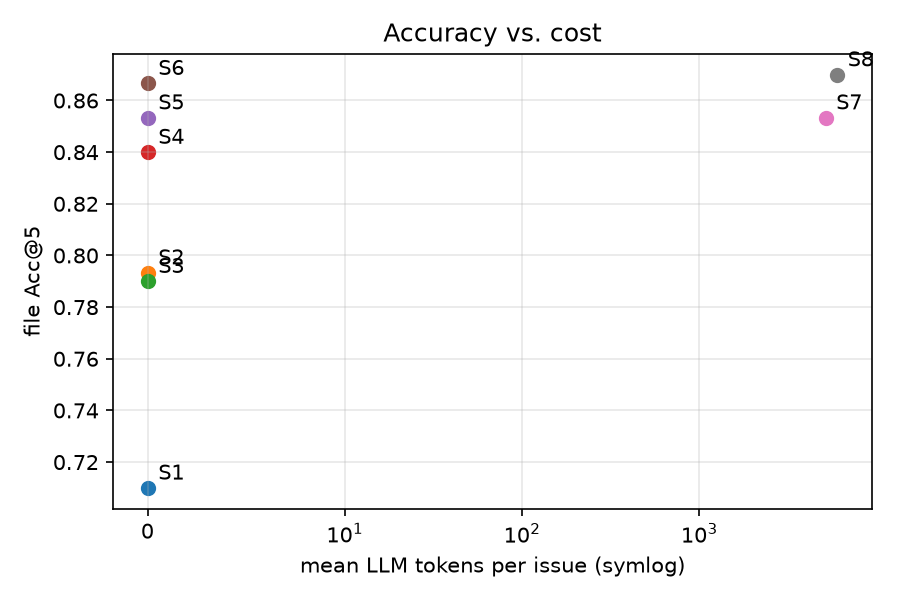
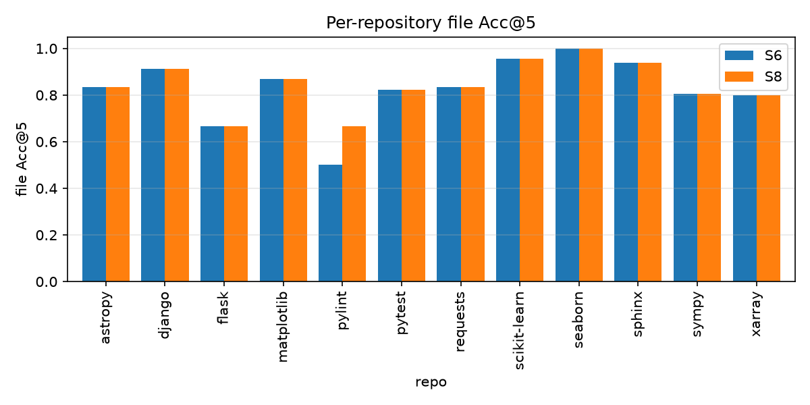
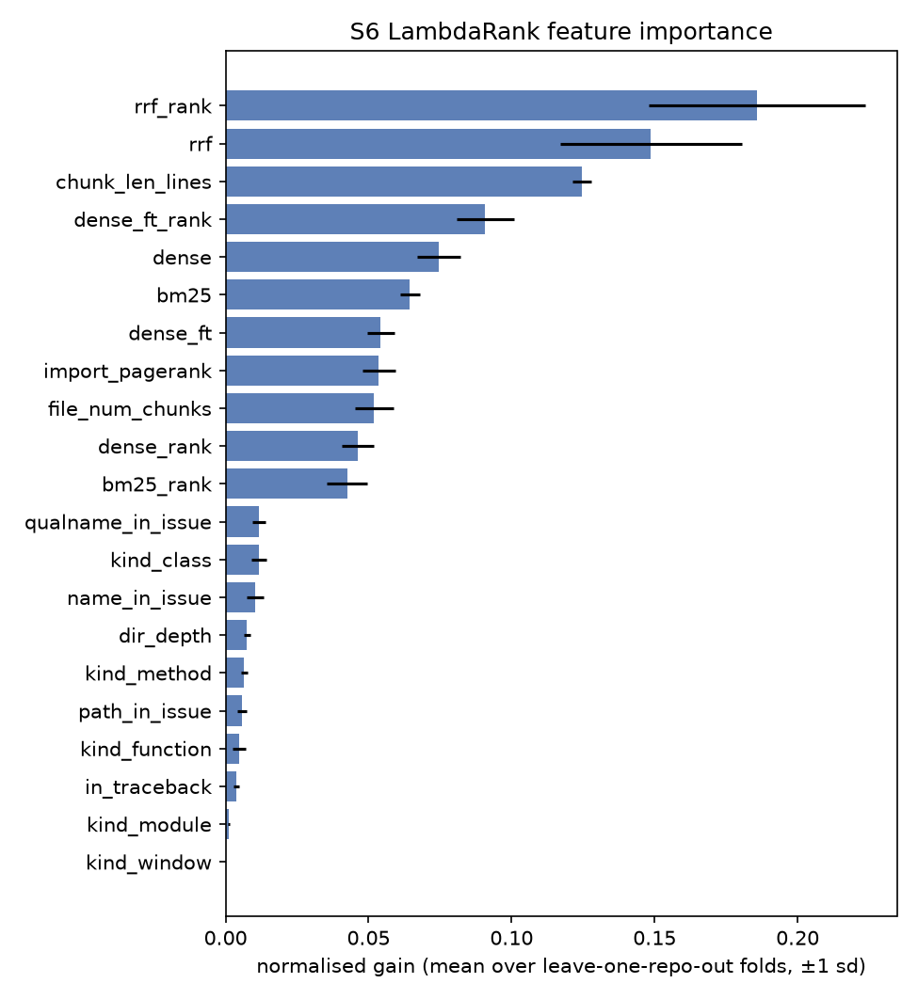
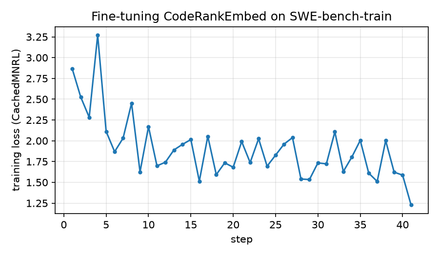

# BugLens results

SWE-bench Lite **test** (300 instances). Cells: mean [bootstrap 95% CI, 1000 resamples, seed 42].

**Best zero-token system: S6** (S5 → LambdaRank) — file Acc@1 0.597 [0.543, 0.650], file Acc@5 0.867 [0.827, 0.903], function Acc@10 0.670 [0.613, 0.723], 0 LLM tokens per issue.

**Best overall system: S8** (S6 → Gemini rerank) — file Acc@1 0.760 [0.710, 0.807], file Acc@5 0.870 [0.830, 0.907], function Acc@10 0.670 [0.613, 0.723], 6002 LLM tokens per issue.

## Main results

| system | pipeline | n | file_acc@1 | file_acc@3 | file_acc@5 | file_mrr | func_acc@5 | func_acc@10 | func_recall@10 | func_mrr | mean_tokens | mean_seconds |
| --- | --- | --- | --- | --- | --- | --- | --- | --- | --- | --- | --- | --- |
| S1 | BM25 | 300 | 0.470 [0.417, 0.527] | 0.653 [0.600, 0.707] | 0.710 [0.660, 0.760] | 0.581 [0.535, 0.629] | 0.437 [0.383, 0.490] | 0.527 [0.470, 0.580] | 0.479 [0.425, 0.532] | 0.311 [0.272, 0.351] | 0.0 | 0.052 |
| S2 | Dense (CodeRankEmbed) | 300 | 0.513 [0.453, 0.573] | 0.727 [0.670, 0.773] | 0.793 [0.743, 0.840] | 0.634 [0.590, 0.680] | 0.463 [0.407, 0.523] | 0.560 [0.507, 0.620] | 0.510 [0.458, 0.565] | 0.327 [0.286, 0.372] | 0.0 | 0.005 |
| S3 | RRF(S1, S2) | 300 | 0.527 [0.470, 0.587] | 0.733 [0.680, 0.780] | 0.790 [0.740, 0.837] | 0.648 [0.604, 0.694] | 0.497 [0.443, 0.553] | 0.590 [0.537, 0.647] | 0.541 [0.488, 0.598] | 0.368 [0.326, 0.412] | 0.0 | 0.005 |
| S4 | Dense (fine-tuned) | 300 | 0.587 [0.527, 0.643] | 0.783 [0.733, 0.827] | 0.840 [0.797, 0.880] | 0.696 [0.650, 0.738] | 0.513 [0.457, 0.573] | 0.610 [0.550, 0.663] | 0.557 [0.498, 0.611] | 0.381 [0.337, 0.427] | 0.0 | 0.004 |
| S5 | RRF(S1, S4) | 300 | 0.593 [0.537, 0.647] | 0.810 [0.763, 0.850] | 0.853 [0.813, 0.893] | 0.708 [0.665, 0.750] | 0.547 [0.487, 0.600] | 0.623 [0.567, 0.677] | 0.579 [0.524, 0.635] | 0.405 [0.359, 0.446] | 0.0 | 0.005 |
| S6 | S5 → LambdaRank | 300 | 0.597 [0.543, 0.650] | 0.807 [0.760, 0.850] | 0.867 [0.827, 0.903] | 0.709 [0.665, 0.749] | 0.577 [0.523, 0.630] | 0.670 [0.613, 0.723] | 0.624 [0.570, 0.675] | 0.413 [0.369, 0.455] | 0.0 | 0.41 |
| S7 | S5 → Gemini rerank | 300 | 0.757 [0.707, 0.803] | 0.830 [0.787, 0.870] | 0.853 [0.813, 0.893] | 0.803 [0.760, 0.842] | 0.613 [0.553, 0.667] | 0.623 [0.567, 0.677] | 0.579 [0.524, 0.635] | 0.571 [0.519, 0.622] | 5168.4 | 4.75 |
| S8 | S6 → Gemini rerank | 300 | 0.760 [0.710, 0.807] | 0.847 [0.803, 0.887] | 0.870 [0.830, 0.907] | 0.811 [0.769, 0.850] | 0.657 [0.600, 0.710] | 0.670 [0.613, 0.723] | 0.624 [0.570, 0.675] | 0.596 [0.549, 0.643] | 6001.8 | 2.516 |

## Paired comparisons

Difference A − B on common instances; paired bootstrap 95% CI and two-sided p; exact McNemar on the binary metric.

| A vs B | metric | n | diff | bootstrap p | McNemar (A only / B only, p) |
| --- | --- | --- | --- | --- | --- |
| S2 vs S1 | file_acc@1 | 300 | +0.043 [-0.013, +0.097] | 0.150 | 41 / 28, p=0.148 |
| S2 vs S1 | file_acc@5 | 300 | +0.083 [+0.033, +0.130] | 0.002 | 40 / 15, p=0.001 |
| S2 vs S1 | func_acc@10 | 300 | +0.033 [-0.023, +0.093] | 0.260 | 44 / 34, p=0.308 |
| S3 vs S2 | file_acc@1 | 300 | +0.013 [-0.037, +0.063] | 0.648 | 31 / 27, p=0.694 |
| S3 vs S2 | file_acc@5 | 300 | -0.003 [-0.043, +0.037] | 0.910 | 17 / 18, p=1.000 |
| S3 vs S2 | func_acc@10 | 300 | +0.030 [-0.013, +0.070] | 0.190 | 24 / 15, p=0.200 |
| S4 vs S2 | file_acc@1 | 300 | +0.073 [+0.027, +0.123] | 0.008 | 40 / 18, p=0.005 |
| S4 vs S2 | file_acc@5 | 300 | +0.047 [+0.007, +0.087] | 0.032 | 27 / 13, p=0.038 |
| S4 vs S2 | func_acc@10 | 300 | +0.050 [-0.000, +0.100] | 0.064 | 36 / 21, p=0.063 |
| S5 vs S3 | file_acc@1 | 300 | +0.067 [+0.023, +0.110] | 0.000 | 34 / 14, p=0.006 |
| S5 vs S3 | file_acc@5 | 300 | +0.063 [+0.030, +0.100] | 0.002 | 23 / 4, p=0.000 |
| S5 vs S3 | func_acc@10 | 300 | +0.033 [-0.003, +0.070] | 0.118 | 23 / 13, p=0.132 |
| S6 vs S5 | file_acc@1 | 300 | +0.003 [-0.043, +0.050] | 0.926 | 24 / 23, p=1.000 |
| S6 vs S5 | file_acc@5 | 300 | +0.013 [-0.010, +0.037] | 0.366 | 9 / 5, p=0.424 |
| S6 vs S5 | func_acc@10 | 300 | +0.047 [+0.010, +0.083] | 0.008 | 22 / 8, p=0.016 |
| S6b vs S6 | file_acc@1 | 300 | -0.007 [-0.040, +0.027] | 0.786 | 11 / 13, p=0.839 |
| S6b vs S6 | file_acc@5 | 300 | +0.007 [-0.010, +0.023] | 0.534 | 4 / 2, p=0.688 |
| S6b vs S6 | func_acc@10 | 300 | +0.020 [-0.007, +0.047] | 0.140 | 10 / 4, p=0.180 |
| S6 vs S7 | file_acc@1 | 300 | -0.160 [-0.207, -0.110] | 0.000 | 8 / 56, p=0.000 |
| S6 vs S7 | file_acc@5 | 300 | +0.013 [-0.010, +0.037] | 0.366 | 9 / 5, p=0.424 |
| S6 vs S7 | func_acc@10 | 300 | +0.047 [+0.010, +0.083] | 0.008 | 22 / 8, p=0.016 |
| S8 vs S6 | file_acc@1 | 300 | +0.163 [+0.107, +0.213] | 0.000 | 58 / 9, p=0.000 |
| S8 vs S6 | file_acc@5 | 300 | +0.003 [+0.000, +0.013] | 0.758 | 1 / 0, p=1.000 |
| S8 vs S6 | func_acc@10 | 300 | +0.000 [+0.000, +0.000] | 1.000 | 0 / 0, p=1.000 |

## RQ4: onboarding summaries as a reranker feature (S6b vs S6)

Subset: 300 instances from repos with package summaries (astropy/astropy, django/django, matplotlib/matplotlib, mwaskom/seaborn, pallets/flask, psf/requests, pydata/xarray, pylint-dev/pylint, pytest-dev/pytest, scikit-learn/scikit-learn, sphinx-doc/sphinx, sympy/sympy).

| system | pipeline | n | file_acc@1 | file_acc@3 | file_acc@5 | file_mrr | func_acc@5 | func_acc@10 | func_recall@10 | func_mrr | mean_tokens | mean_seconds |
| --- | --- | --- | --- | --- | --- | --- | --- | --- | --- | --- | --- | --- |
| S6 | S5 → LambdaRank | 300 | 0.597 [0.543, 0.650] | 0.807 [0.760, 0.850] | 0.867 [0.827, 0.903] | 0.709 [0.665, 0.749] | 0.577 [0.523, 0.630] | 0.670 [0.613, 0.723] | 0.624 [0.570, 0.675] | 0.413 [0.369, 0.455] | 0.0 | 0.41 |
| S6b | S6 + pkg_summary_sim | 300 | 0.590 [0.537, 0.647] | 0.830 [0.787, 0.870] | 0.873 [0.833, 0.910] | 0.712 [0.669, 0.753] | 0.583 [0.527, 0.633] | 0.690 [0.637, 0.740] | 0.652 [0.601, 0.701] | 0.426 [0.384, 0.467] | 0.0 | 0.034 |

## Ablation A1: hints appended to the query

| system | pipeline | n | file_acc@1 | file_acc@3 | file_acc@5 | file_mrr | func_acc@5 | func_acc@10 | func_recall@10 | func_mrr | mean_tokens | mean_seconds |
| --- | --- | --- | --- | --- | --- | --- | --- | --- | --- | --- | --- | --- |
| A1 | S5 + hints in query | 300 | 0.643 [0.590, 0.697] | 0.840 [0.793, 0.880] | 0.890 [0.853, 0.927] | 0.749 [0.709, 0.789] | 0.613 [0.560, 0.667] | 0.697 [0.643, 0.750] | 0.649 [0.598, 0.696] | 0.468 [0.422, 0.513] | 0.0 | 0.016 |
| S5 | RRF(S1, S4) | 300 | 0.593 [0.537, 0.647] | 0.810 [0.763, 0.850] | 0.853 [0.813, 0.893] | 0.708 [0.665, 0.750] | 0.547 [0.487, 0.600] | 0.623 [0.567, 0.677] | 0.579 [0.524, 0.635] | 0.405 [0.359, 0.446] | 0.0 | 0.005 |

## Figures

## Fine-tuning (RQ2) — validation on held-out repositories

2571 train / 429 val pairs (repo-disjoint).

| metric | before | after |
| --- | --- | --- |
| val_cosine_accuracy@1 | 0.231 | 0.238 |
| val_cosine_accuracy@10 | 0.538 | 0.599 |
| val_cosine_mrr@10 | 0.328 | 0.351 |
